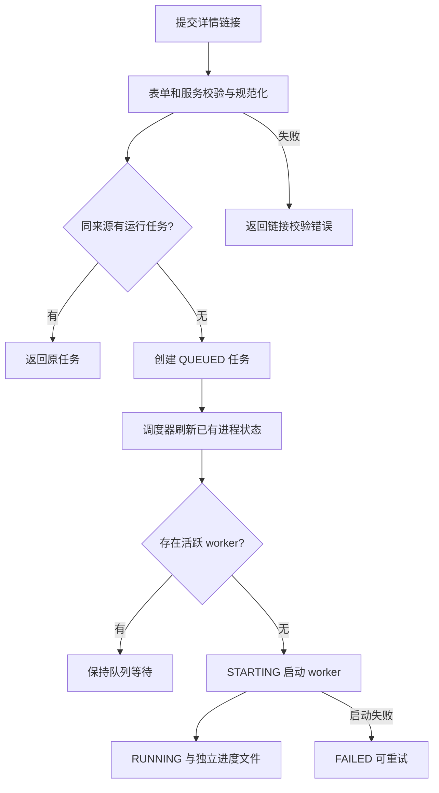
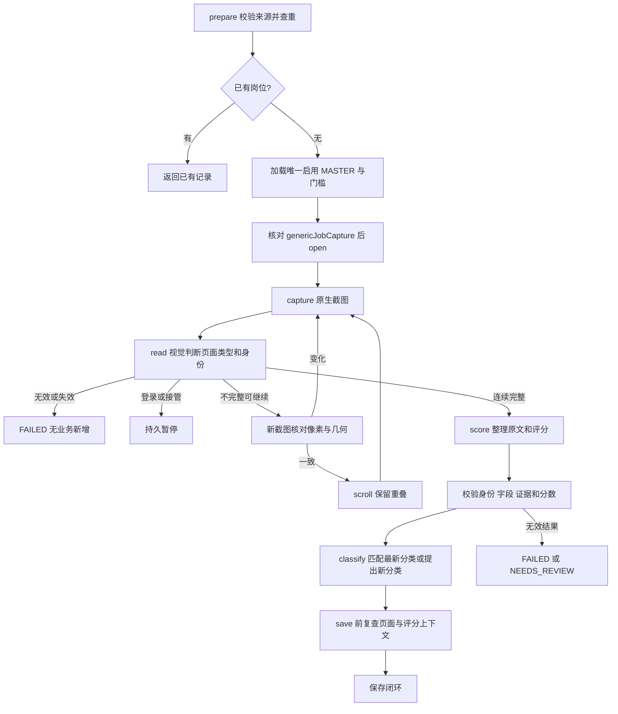
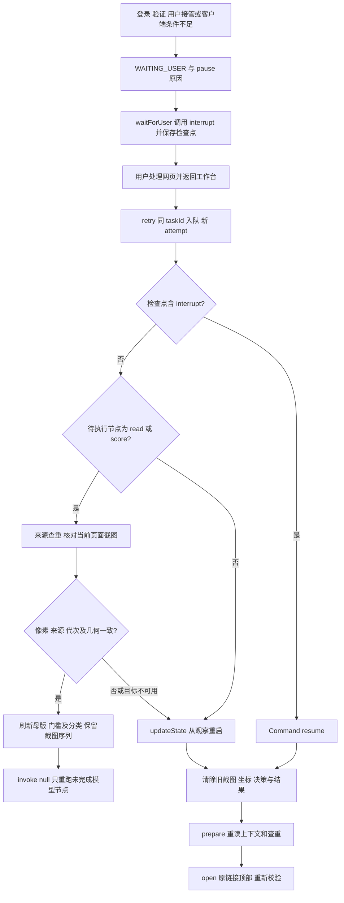
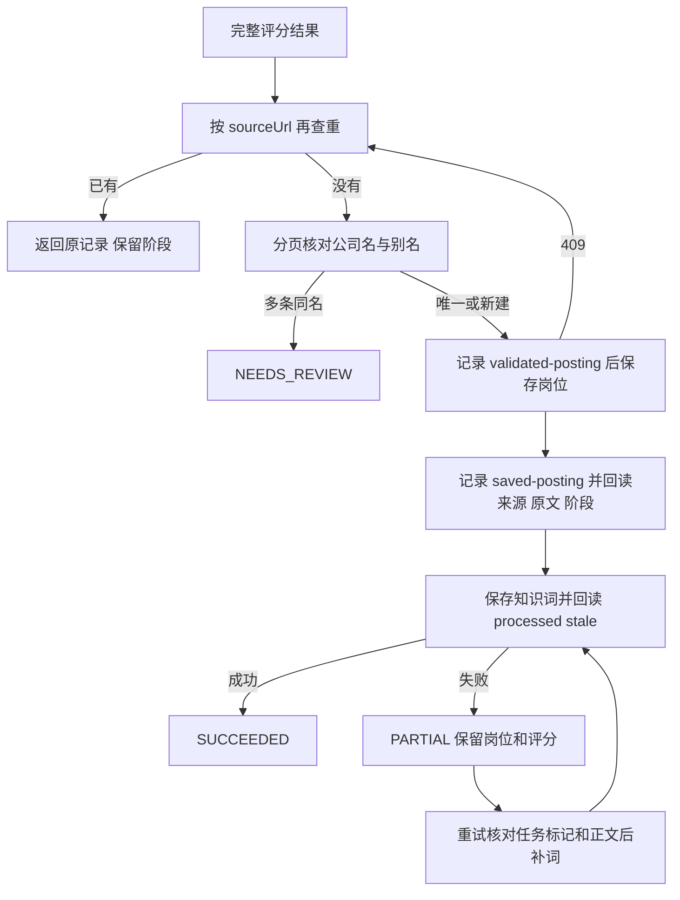

# JD采集与截图识别

状态：原生截图、受限输入、视觉结果校验与旧 DOM 退役已实现。2026-10-17 通用链接收录 v3 已接入 LangGraph 后台编排、首屏有效性判断和检查点恢复，完成真实蔚来官网两屏读取、独立 H2 的 HTTP 保存回读及正常客户端重启启用。2026-09-09 的 BOSS 单岗位验收仍作历史记录；具体范围及未覆盖项见[验收方案](#4-验收方案)。本功能负责平台列表采集与通用单岗位链接收录。[账号与登录态](03-招聘平台账号与登录态.md)提供可接续的网站会话，[JD管理与评分](05-JD管理与评分.md)拥有最终岗位实体及评分规则。

## 1. 需求分析

### 链接自动收录

#### 目标与本期包含

求职者在“新增 JD”粘贴招聘网站或企业官网的岗位链接，由系统在后台读取、核对、评分并保存为已筛选岗位；用户可继续使用其他标签和应用。当前版本为通用链接收录 v3，已实施，验收范围见[通用链接收录验收](#通用链接收录验收)。

| 编号 | 能力 | 完成边界 |
| --- | --- | --- |
| IN-L1 | 通用岗位链接 | 接受招聘网站、企业官网的 HTTPS 链接；保留定位岗位所需参数 |
| IN-L2 | 首屏有效性 | 区分岗位详情、加载、登录、验证、首页/列表、失效岗位和无法确认 |
| IN-L3 | 完整正文 | 每张图核对岗位身份、前后重叠及正文边界，完整后统一提取和评分 |
| IN-L4 | 后台与恢复 | 收录不切标签；登录、验证或接管时暂停；关闭弹窗和重启后保留任务 |
| IN-L5 | 保存闭环 | 查重、匹配公司、保存岗位和评分、回读、保存知识词，并显示最终结果 |

#### 核心业务流程

粘贴详情链接 → 提交任务 → 后台打开 → 首屏判断有效性 → 按正文连续性分段读取 → 完整后整理与评分 → 查重、保存并回读 → 工作台显示已收录。

| 关键规则 | 业务口径 |
| --- | --- |
| 岗位身份 | 必须可确认同一岗位与公司；推荐岗位和列表卡片不合并到正文 |
| 完整性 | 同时确认正文开头、结尾及中间连续性；仅看到页面底部不足以认定完整 |
| 评分依据 | 使用当前启用母版简历和已确认门槛；未知薪数、日期、地点不补写，未知通勤计零分 |
| 重复处理 | 已收录的同一来源链接返回已有记录，保留原评分与阶段 |
| 任务恢复 | 用户处理网页后返回工作台继续；重新核对页面，不能沿用验证前的截图和坐标 |
| 结果状态 | 新岗位为已筛选；命中门槛阻断仍保留并评分；知识词失败显示部分完成 |

#### 异常分支

| 场景 | 处理 | 用户可见结果 |
| --- | --- | --- |
| 非完整 HTTPS 链接 | 表单/服务校验 | 明确提示修正链接 |
| 首页、列表、无关页或已下架 | 首屏拒绝收录 | 更换有效岗位详情链接，业务记录不新增 |
| 登录、验证、用户打开任务标签 | 暂停任务 | 打开收录标签处理，再返回工作台继续 |
| 加载或持续变化 | 有限等待后暂停 | 保留任务并显示具体原因 |
| 缺段、裁切、身份变化、读取超限 | 保留证据待核对 | 不保存半篇 JD |
| 模型或本地接口失败 | 保留结果与任务 | 失败原因可见，允许显式重试 |
| 保存结果不确定或知识词失败 | 重试先查已有记录 | 核对本任务后补齐知识词，保留岗位阶段 |

#### 成功标准

| 编号 | 可验证结果 | 验证方式 |
| --- | --- | --- |
| S-L1 | 官网与招聘网站详情链接均可提交，岗位参数不丢失 | 表单与接口核对规范化来源 |
| S-L2 | 非 JD/失效页不评分、不新增公司或岗位 | 首屏决策、调用次数与写入记录 |
| S-L3 | 长 JD 逐图核对，正文完整后才评分 | READ/SCORE 顺序与原文截图对照 |
| S-L4 | 收录保持当前标签/焦点；接管后可暂停恢复 | 原生隔离夹具与检查点恢复 |
| S-L5 | 新增结果、已筛选阶段及知识词可回读；重复不覆盖 | 真实 HTTP、最终记录与来源条数 |
| S-L6 | 同来源重复提交复用运行任务，同客户端单任务执行 | 队列、并发请求与进程身份核对 |

### 背景与目标

以下背景、平台 Skill 和批次协议描述列表采集链路；通用单岗位链接的状态、接口和验收分别见各章节“通用链接收录”小节。两条链路共用原生截图与业务域，编排及复核方式各自明确。

用户通过对话提出求职条件，账号页只承担打开/返回平台，登录与验证码在网站内由本人完成。历史读取曾依赖页面选择器与特殊数字字形转换，容易受到布局和渲染变化影响。当前采用“页面截图 → 视觉识别 → 主 Agent 核实 → 按授权归档”，以实际显示内容作为岗位证据。

截图能降低对 DOM 结构、字体编码的依赖，但仍受页面加载、登录、网站验证、图片清晰度和可见范围约束；不把截图方式等同于绕过平台限制。

### 使用对象与职责

| 对象 | 职责 |
| --- | --- |
| 用户 | 描述岗位条件，在平台页面完成登录、验证码及必要身份确认 |
| 主 Agent | 控制页面、选择图片、调度识别、核实来源和通勤、评分、按授权保存 |
| 后端recognition与Codex CLI | 定时读取新截图批次，启动Astra/medium，保存字段、证据、不确定项及状态 |
| Electron | 平台会话、标签、截图、受限页面操作；不承担模型调度和业务评分 |

### 本期范围、边界与确认清单

| 优先级 | 范围 | 交付口径 |
| --- | --- | --- |
| P0 | 视觉 workflow | 用公共截图能力读取可见列表和详情；页面元数据只用于目标、URL与导航状态 |
| P0 | 长 JD | 滚动分段、重叠核对，检查横向截断，明确完整/部分/不可读 |
| P0 | 异步识别 | 后端定时启动Codex CLI，默认GPT-6 Astra/medium，支持本地显式配置，使用共享Prompt；主Agent集中复核 |
| P0 | 平台适配 | 维护 BOSS 页面布局识别、搜索操作、登录停点、预览定位与结束判定 |
| P0 | 归档 | 复用 posting/company 现有接口；保留来源、证据和缺口，防止串岗位和重复新增 |
| P0 | 首站闭环 | BOSS 真实页面完成截图识别、集中复核、查重保存及回读 |

列表链路采用Java后端定时扫描截图工作目录，通过Node执行器启动独立Codex CLI；链接任务由独立队列启动 LangGraph worker。二者复用本机Codex登录，不接入额外模型API。用户不操作截图、标签选择或“读取岗位”按钮；模型只识别冻结图片，链接任务的页面控制与保存由图节点执行。平台内发消息、投递、上传简历、自动验证码处理不属于采集授权。本方案保持独立功能文档；原持久分区不变，测试使用隔离数据环境。

默认使用GPT-6 Astra/medium作为JD识别核心，新用户可在本地配置中明确选择有图片能力的模型与强度；标准Prompt统一维护于项目Skill共享资源。原生截图与页面操作已按用户授权实施；模型效果由样本验证，不把选择medium等同于已证明总体准确率。

### 核心需求

**截图读取、Electron原生执行**：截图使用capturePage，点击、滚动与键盘使用sendInputEvent，文字使用insertText；统一通过受限本地workflow调用，不启用调试端口。真实招聘页禁止DOM、locator、语义选择器、无障碍树、页面脚本和网络响应读取或定位控件。主Agent根据截图确定坐标，动作绑定最新截图与目标页，页面或几何变化即停止重看。URL、标签key、viewport只作来源和几何元数据。本地工作台与隔离夹具可使用测试专用元素断言，该能力不进入生产管道。

| 需求 | 输入与输出 | 规则与成功判定 |
| --- | --- | --- |
| 找到目标页面 | 用户条件 → 对应平台标签 | 主 Agent 使用已有标签；不要求本人选择 key；不重载已打开岗位 |
| 判断可继续 | 可见页面 → 登录/验证/未知状态 | “页面已打开”及 Cookie 存在不算登录证明；验证页交回用户 |
| 列表初筛 | 列表截图 → 可见卡片线索 | 每卡独立；详情预览不能补给其他卡；省略号和画面外字段留空 |
| 详情核实 | 明确岗位的多张图 → 原文、字段、证据 | 职责/要求及可见办公点逐段识别；正文被裁切不宣称完整 |
| 来源定位 | 实际导航元数据 → 官方详情链接 | 禁止子 Agent 猜 URL；SPA 同URL切换还需标题、公司和画面锚点 |
| 主 Agent 审核 | 候选与证据 → 接受、补图或待核实 | 标题、公司、薪资数字/薪数、地址、年限及来源逐项核对 |
| 归档 | 用户采集/更新授权 + 已复核内容 → JD | 查重后保存；新增 SCREENED；没有自动投递、跟进时间或日历任务 |

筛选先通过 GET `/api/criteria` 读取本地配置的最新确认答案；城市、薪资、经验、学历、公司规模、工作安排和通勤要求均由用户配置。通勤结合具体办公点及路线来源核实，不从区域名或截图推断。评分和等级沿用 JD 模块口径。

### Electron原生操作与验证入口

- `node src/app/electron/workflow.mjs BOSS capture --key KEY` 获取截图；按图片坐标使用 `click --key KEY --capture ID --x X --y Y --intent searchControl`，每次动作后重新截图。
- `type --key KEY --capture ID --text "AI应用开发" --replace true` 在已确认的搜索框内全选替换；默认不提交。`key --key KEY --capture ID --key-code Enter` 提交搜索；每个动作均使用新截图ID。
- 按键白名单：SelectAll、Backspace、Delete、Enter、Tab、Escape、ArrowLeft/Right/Up/Down、Home、End。输入与编辑键保持搜索上下文；Enter/Tab/Escape结束该上下文，下一次编辑须重新看图点击。
- BOSS `filters:*`命令统一复用原生管道。录制步骤绑定平台、标签、视口、缩放和PNG；旧步骤须重新校准。批量执行每步先取新图校验锚点，再提交受限动作，失败不重发。
- BOSS 的操作流程统一维护在 [BOSS 采集 SOP](../.agents/skills/jd-boss/SKILL.md)；筛选、批次、复核与归档按该文件执行。本功能文档维护实现、协议及验收证据，不作为第二套操作 SOP。
- 2026-10-02已补齐BOSS学历与明确多选档位步骤，在7890真实列表、1056×1526逻辑视口、90%页内缩放下录制完整配方并按地点→经验→薪资→规模→学历→全职批量重放，随后集中核验真实勾选。证据位于本项目忽略目录`runtime/search-filters/BOSS/verification-20261002.json`。清空地点会关闭面板，配方显式重新展开；规模通过先清空再选100–499／500–999／1000–9999，避免沿用10000以上的旧选择。配方只适用于当前key、几何与PNG锚点，不代表后续全片区已采集。
- 已删除原调试连接、`desktop:automation`和启动脚本的自动化参数。正常启动即可使用原生workflow；修改主进程后需要重启客户端才能加载新能力。
- `npm run test:desktop`运行纯协议/边界测试及隔离Electron桌面夹具；`npm run test:e2e`运行Electron工作台流程。保留原业务断言，截图、点击、键盘由Electron执行；元素与主进程脚本读取只存在于测试宿主，不编入生产包。
- 页面测试默认拦截未模拟写请求；真实写入主链路只在准备好隔离后端并设置`JD_TEST_ALLOW_WRITES=1`时显式运行。报告中必须区分通过、失败与跳过；视口截图不冒充整页或PDF验收。

### 能力与后台边界

| 归属 | 内容 |
| --- | --- |
| 采集原生层（app/common） | 图片产出、受限页面输入、本地通信、坐标与页面代次、文件生命周期 |
| 采集workflow | 平台定义与独立 workflow/Skill、视觉字段协议、识别与复核规则 |
| JD管理 / 公司资料 | 现有公司匹配、来源查重、评分、保存；不接管浏览器 |

### 兼容与版本规则

- 平台原持久化分区、固定 JD 标签、已有岗位和历史密文/密钥原样保留。
- 新 workflow 不调用 DOM 正文解析、字体数字解码或页面内部接口；允许使用原生 URL、标题和加载事件。
- 旧 inspect/read/diagnose 从日常 Skill 和 Agent 传输入口退役，不默默回退到 DOM；正文提取/字体解码及 diagnostics.ts 已移除，原生测试替换旧 DOM 断言。
- 识别结果使用 schemaVersion=1；截图协议由基础层定义。证据保存在被 Git 忽略的 runtime，不新增渐进需求文档，也不新增数据库字段。
- 历史 DOM 读取成功记录仅作为旧链路结果，不代表新截图链路验收。

### 可行性与工作量评估

| 项目 | 判断 / 预估 |
| --- | --- |
| Electron 截图 | 已核对官方 capturePage API，返回可见区域 NativeImage；项目已有对应 WebContentsView，CLI 已接入截图与受限输入 |
| 模型图片输入 | Codex CLI以--image传入原生PNG，图片路径之后用`-- -`分隔标准输入，避免`-`被当作图片文件；默认GPT-6 Astra/medium，该默认组合的真实详情及列表任务已验证，其他配置须独立验证 |
| 基础截图/坐标/受限输入 | 约1–1.5个开发日，含不同缩放与并发边界 |
| BOSS workflow/证据复核/隔离验收 | 约1–1.5个开发日 |
| 合计 | 约3–5个开发日，是工程估算，不是承诺连续无人值守运行 |

依据：[Electron 截图](https://www.electronjs.org/docs/latest/api/web-contents#contentscapturepagerect-opts)、[Astra 图片输入与推理配置](https://developers.openai.com/api/docs/models/gpt-6-astra)、[Codex 子 Agent 配置与调度](https://learn.chatgpt.com/docs/agent-configuration/subagents)。核对日期：2026-09-09。

### 成功标准

| 编号 | 标准 |
| --- | --- |
| S1 | 用户只描述岗位与处理网站认证，Agent 完成可见内容获取、核对、汇报 |
| S2 | 关键字段均能定位到指定图片证据，未知不猜、部分不冒充完整 |
| S3 | 列表/详情/多图不串岗位；原始图片和识别修订可追溯 |
| S4 | 同样本模型试验与实际平台闭环分别记录；通过的仅限实际测试平台 |
| S5 | 按用户授权归档，数据库最终状态正确且无自动投递、跟进或覆盖 |

### 原生截图与输入需求


> 状态：下述截图与输入已接入本地 workflow；可执行命令见开发方案和公共 Skill。

#### 目标与能力边界

提供“指定平台标签 → 可见页面 PNG + 元数据”的稳定接口，由 Codex 使用图片工具查看并分派识别。原生能力继续放在 app 装配、common/desktop/main 实现，业务模块不导入 Electron。平台配置仍由account代码域提供；采集workflow负责视觉流程；原生层不识别岗位、不评分、不调模型。

| 优先级 | 本期能力 | 成功口径 |
| --- | --- | --- |
| P0 | 标签级截图 | 只截目标 WebContentsView，不截整个桌面、其他窗口或工作台 |
| P0 | 图片定位 | 返回图片路径、尺寸、时间、页面代次与哈希；支持受限区域裁图 |
| P0 | 页面操作 | 目标标签的滚动、点击与搜索框输入，均绑定最新截图 |
| P0 | 坐标一致性 | 区分PNG像素、页面坐标、窗口位置、DPI与缩放；尺寸变更使旧动作失效 |
| P0 | 单窗口串行 | 一次一个可交互目标，其他标签及登录会话保留 |
| P0 | 有限失败 | 空白、页面变化、目标关闭、失焦、超时明确返回，不无限操作 |
| P0 | 本地证据 | runtime下保存PNG与JSON；不进Git、不导出Cookie |

截图不保证得到不可见区域。长文滚动拼接、双栏归属和登录判断由采集workflow的主Agent视觉流程承担。本人正在操作窗口时，Agent暂停并重新取图，不能抢占用户输入。外站仍没有工作台preload或任意脚本入口。

#### 兼容、范围确认与工作量

沿用原生单窗口、持久分区、顶部导航、固定JD标签和命名管道。新能力只增加到本地Agent传输，不增加Vue手动截图/读取按钮；原工作台请求/事件机制不变。旧DOM命令的退役由采集workflow统一规定。

本期先确认capture、scroll、click、type四项能力及截图绑定校验；后台仍提供原有健康与业务接口，不新增截图HTTP服务或数据库表。预计实现与隔离回归1–1.5个开发日，计入采集workflow总估算，不重复累加。

#### 可行性依据

项目使用Electron 44.2.0，平台页面已有独立WebContentsView。官方`webContents.capturePage`返回NativeImage；省略区域时截的是整个可见页面，不是全滚动文档；`NativeImage.toPNG`返回PNG数据。普通 workflow 在各自客户端内串行操作当前选中页；`JD_DESKTOP_BACKGROUND_WORKFLOW=true`时允许宿主未获系统焦点，仍要求可见、未最小化，并保持目标、代次、几何、时效和像素校验。两个隔离客户端的后台原生输入已有独立夹具验证，不在同一页面并发操作，不因采集移动或激活用户系统窗口。

参考：[截图与输入](https://www.electronjs.org/docs/latest/api/web-contents)、[PNG编码](https://www.electronjs.org/docs/latest/api/native-image#imagetopngoptions)。原生截图、BOSS真实详情及通用后台离屏任务的不同验收范围见第4节。

## 2. 架构设计

> 当前实现分层；目录差异标记对应本功能变更。

Prompt、平台 Skill 与原生 capture/scroll/click/type/key 已建立；目录标记不替代第4节实际验收结论。

### 通用链接收录架构

```text
用户粘贴链接 / 继续任务
└─ posting 弹窗 → recognition 任务队列（同客户端串行）
   └─ Node worker → LangGraph StateGraph + 文件检查点
      ├─ prepare：校验、查重、母版与门槛
      ├─ open → capture → read
      │  ├─ 继续读取 → scroll → capture
      │  ├─ 正文完整 → score → save → 回读岗位与知识词
      │  ├─ 登录/验证/用户接管 → waitForUser → 用户继续 → prepare
      │  └─ 无效页/不完整/模型失败 → 保留任务和证据
      ├─ WEB 原生管道 → 离屏 WebContentsView → PNG / 受限滚动
      └─ 独立只读 Codex CLI → 页面判断 / 完整性 / 结构化评分
```

| 模块 | 责任 | 存储归属 |
| --- | --- | --- |
| posting 弹窗 | 提交链接、展示状态、继续/重试、手动打开任务标签 | 消费任务快照 |
| recognition 队列 | 创建、轮询、串行调度、识别运行进程及完成状态 | 每任务目录内 task/state 与各 attempt |
| LangGraph | 节点、条件转移、暂停与恢复；校验模型决策后调用原生能力和业务保存 | graph.checkpoint 与步骤证据 |
| Electron 公共层 | 后台标签、分区、页面代次、截图、绑定截图的滚动、手动接管 | userData、原生 PNG 与 manifest |
| 模型读取 | READ 看图判定，SCORE 整理完整原文及评分 | 每次模型输入、输出、调用元数据 |
| 既有业务域 | 公司关联、岗位和评分、知识词 | 各领域既有存储 |

| 对象/场景 | 关键规则 |
| --- | --- |
| 来源 | 网页内容只从原生截图取得；初次规范跳转可接受，收集过程中导航则重取 |
| 分区 | 已注册网站复用平台分区；其他网站按主机分区，与普通网页共享登录状态 |
| 后台 | 离屏页不选择标签、不聚焦宿主；截图和滚动允许宿主失焦、隐藏或最小化 |
| 接管 | 用户打开任务页时切成同分区普通视图，自动动作暂停；继续后重建离屏视图 |
| 恢复 | 同任务使用同一图线程；恢复清除旧截图和坐标，从原链接顶部重新观察 |
| 初筛与收录 | BOSS 列表仍由平台 Skill 初筛；链接任务独立运行通用单岗位图流程 |

核心存储模型如下；字段、枚举和接口在开发方案展开。

| 模型 | 内容 | 生命周期 |
| --- | --- | --- |
| 任务快照 | 来源、标签、状态、尝试次数、结果关联 | 跨进程保留；队列按进程身份接续 |
| 图状态 | 来源、上下文、截图序列、身份、决策、重试计数、暂停和结果 | 每节点持久化；恢复刷新页面证据 |
| 决策 | 页面类型、身份、完整性、动作及整理结果 | 绑定真实截图和本次模型调用 |

标记：`[+]` 新增，`[~]` 修改；对应通用链接与 LangGraph 功能变更。

```text
jd-collector/
├─ .agents/skills/[~] jd-import-prompt.md
├─ backend/recognition/src/main/java/com/jd/recognition/
│  ├─ ctrl/[~] PostingImportController.java
│  └─ service/[~] PostingImportService.java
├─ frontend/src/
│  ├─ posting/
│  │  ├─ components/[~] PostingImportDialog.vue
│  │  └─ pages/[~] PostingsPage.vue
│  ├─ app/electron/[~] workflow.mjs
│  └─ common/desktop/
│     ├─ [+] jobUrl.mjs / jobUrl.d.mts
│     └─ main/[~] workflowBrowser.ts / browserWindows.ts
├─ ops/
│  ├─ [~] build.ps1
│  └─ jd-import/
│     ├─ [~] importer.mjs / worker.mjs / model.mjs / importer.test.mjs
│     └─ [+] checkpointer.mjs / package.json / package-lock.json
└─ frontend/tests/
   ├─ [~] posting-import.spec.ts
   └─ desktop/[~] posting-import.spec.ts / mcp-browser.spec.ts
```

运行数据继续存放在忽略目录：队列和检查点属于任务目录，截图属于客户端证据目录，最终业务记录由既有业务接口保存。检查点保存 LangGraph checkpoint 与 pending writes，使用原子文件替换；此流程复用现有实体和字段。

### 总体架构

```text
用户：求职条件 / 在平台内登录
└─ Codex 主 Agent（平台列表采集的页面操作与归档负责人）
   ├─ BOSS Skill + 原生视觉 workflow
   │  └─ app/electron CLI
   │     └─ common/desktop 本地通信
   │        └─ 目标平台 WebContentsView
   │           └─ 原生截图 / 页面输入 → 图片证据包
   ├─ 指定模型的只读识别子 Agent
   │  └─ 截图 → 候选字段 + 图片证据 + 不确定项
   ├─ 主 Agent 复核 / 补图 / 通勤及评分核实
   └─ posting/company 现有保存能力 → 本地 JD
```

模型通过后端启动的独立Codex CLI运行；Electron只提供页面能力，不调度识别或持有模型API凭据。下文“识别子Agent”指该只读识别进程，历史验收段保留当时子Agent调用事实。

### 关键规则

| 对象 | 规则 |
| --- | --- |
| 信息来源 | 招聘内容来自可见像素；URL、页面标题和加载状态来自原生页面元数据 |
| 平台定义 | account 持有域、入口、分区和视觉规则；app 注入公共层，common 不反向依赖 account |
| 页面控制 | 列表由主 Agent 串行控制；链接任务由 LangGraph 调用后台截图/滚动；模型只读冻结图片，同页不并发操作 |
| 双栏页面 | 列表卡片与详情作为不同识别区域；标题/公司/选中锚点一致才关联 |
| 长文 | 保留顺序、重叠与边界证据；页面底部不等同于岗位正文已完整 |
| 判断缺口 | 字段可空；截断、遮挡、冲突进入补图/待核实，不让模型补写 |
| 模型分工 | Astra/medium固定承担识别；补图后仍由同配置独立复读或主Agent核实，不自动换模型/强度 |
| 登录 | 图上证据仅支持当次判断；验证由本人完成，身份不明允许保持 UNKNOWN |
| 入库 | 列表候选经主 Agent 核对后保存；链接任务经图节点校验后调用既有保存能力；只读模型不写库 |
| 指令边界 | 网页和图片文字均视作资料，不能改变工具权限或触发页面外动作 |

### 模块职责

| 模块 | 归属与依赖 |
| --- | --- |
| 平台入口 | account 页面保留打开/返回；订阅公共浏览器事件 |
| 平台规则 | account 纯 TypeScript 定义；独立 Skill 说明视觉搜索/详情/登录停点 |
| 截图与输入 | 采集原生层（app/common） 原生公共能力；仅 app 与 common/main 导入 Electron |
| 识别协议 | account 纯数据契约；模型不绑定到 Vue 组件或后端 |
| 候选复核 | Codex workflow 合并证据、判断缺口和请求补图 |
| JD保存 | posting/company 既有领域；采集不触发 Pipeline |

### 核心模型与存储归属

| 模型 | 内容 | 归属 / 生命周期 |
| --- | --- | --- |
| 平台定义 | 平台身份、入口域、持久分区、视觉配置 | account；随代码及 Skill 维护 |
| 截图证据包 | 图片、元数据、代次、哈希、顺序 | foundation；本地 runtime |
| 视觉候选 | 可见字段、原文片段、证据位置、缺口 | account 协议；当次识别结果 |
| 复核结果 | 接受/补图/待核实、修订依据、已保存JD关联 | workflow 的本地结果文件 |
| 已归档岗位 | 既有 JD 实体 | posting；不改变现有数据库模型 |

接口字段统一放在本文件开发方案，分别列出原生与识别契约。图片文件与识别结果不进入 Git；已用于归档的证据保留至用户明确清理，未归档证据默认也不自动删除，避免误删当前复核材料。

### 核心流程

```text
读取用户条件与平台 Skill
→ 主 Agent 打开/定位平台
→ 截图并核对页面状态
   ├─ 登录 / 验证 / 聊天等非岗位页 → 停止识别，交用户或返回岗位页
   └─ 可见岗位页
      → 列表截图初筛
      → 主 Agent 打开具体岗位并取得实际来源
      → 详情分段截图、去重、核对同一岗位
      → 子 Agent 提取（只读）
      → 主 Agent 对照截图复核
         ├─ 缺口 / 冲突 → 补图或疑难复核 → 仍不清楚则待核实
         └─ 证据充分
            → 核实办公点、通勤、方向、评分
            → 按用户授权查重/保存 → 读取最终状态
```

```text
页面操作 → 原证据失效用于后续点击
新截图 → 绑定新代次/尺寸/图片锚点
同URL内容切换 → 重新核对岗位身份，不复用旧详情
用户抢占窗口或调整尺寸 → 暂停动作，重新截图
```

### 模块目录

标记：`[+]` 新增，`[~]` 修改，`[-]` 删除；以下为本功能实施范围。

```text
jd-collector
├─ .agents/skills
│  ├─ [~] platform-workflow.md
│  ├─ [+] jd-vision-prompt.md           BOSS 识别指令与任务格式
│  └─ jd-boss/[~] SKILL.md
└─ frontend
   ├─ src/account
   │  ├─ adapters/[~] platforms.ts       保留平台定义，退役 DOM 提取/字体解码
   │  ├─ adapters/[-] diagnostics.ts     退役结构抓取
   │  └─ [+] vision.ts                  识别及证据纯类型、协议/完整性校验
   ├─ src/app/electron/[~] main.ts       装配公共能力
   ├─ src/common/desktop/[~] platform.ts 退役旧页面读取契约
   └─ tests/desktop
      ├─ [-] platform.spec.ts            移除 DOM 读取断言，改为 capture.spec.ts
      └─ [+] vision.spec.ts              识别协议与复核夹具
```

原生截图与受限操作的文件拆分见下方“原生截图与输入设计”；两层共同服务本功能，仍保持代码分层。

### 原生截图与输入设计


> 下列能力已实现，异常及平台验证范围在验收章节分别记录。

```text
Codex 主 Agent
└─ app/electron/workflow.mjs
   └─ common/desktop/main/workflowServer
      ├─ BrowserWindows：标签、会话、页面代次、焦点
      ├─ capture：目标view图片与元数据
      └─ visualInput：绑定截图的受限页面动作
         └─ 平台 WebContentsView
            └─ runtime/captures：PNG + manifest
               └─ Codex 读图 / 只读子 Agent
```

| 对象 | 规则 |
| --- | --- |
| 原生边界 | app入口装配；common/main执行；account仅提供纯平台配置 |
| 截图目标 | 显式平台和标签；不以“当前桌面”隐式选择目标 |
| 几何 | 图片像素与页面输入坐标分离，裁图保留原区域及转换关系 |
| 并发 | 全局单次页面输入锁；不同冻结证据可并行识别 |
| 时效 | 页面代次、目标、尺寸、缩放、图像锚点共同校验；URL相同不等于内容相同 |
| 元数据 | 本地路径和经允许规则处理的来源；不含会话秘密 |
| 文件 | 固定runtime根，由原生层生成名字；调用方不能传任意写入路径 |
| 登录 | 持久分区不变；基础层不通过DOM或Cookie判定认证 |

#### 核心模型

| 模型 | 责任 | 存放 |
| --- | --- | --- |
| CaptureRef | 记录图片身份、目标与几何信息 | manifest与内存索引 |
| VisualAction | 绑定截图的有限动作及结果 | 当次通信，不落业务表 |
| EvidenceBatch | 多张图的顺序、哈希和归档关联 | runtime本地JSON，识别结果由account流程维护 |

具体字段见开发方案。PNG是不可变证据；新截图生成新ID，不覆盖旧图。模型坐标只用于复核建议，不能跳过主Agent确认直接执行动作。

#### 链路

```text
capture请求
→ 校验平台/标签/页面状态 → 确认目标可见
→ 截图前元数据 → 原生capturePage → 截图后元数据
   ├─ 目标/代次/尺寸变化 → 丢弃本次结果
   └─ 一致且图片非空 → PNG与manifest落盘 → 返回引用
```

```text
页面动作请求 + 最近截图
→ 校验目标/焦点/几何/时效
→ 动作前重取目标区域核对锚点
   ├─ 变化/用户接管 → 拒绝，重新截图
   └─ 一致 → 单次输入 → 作废旧动作引用 → 重新截图确认效果
```

#### 模块目录

标记：`[+]` 新增，`[~]` 修改；目录为实际实施差异。

```text
jd-collector
└─ frontend
   ├─ src/app/electron
   │  ├─ [~] workflow.mjs               参数入口
   │  └─ [~] main.ts                    配置装配
   ├─ src/common/desktop
   │  ├─ [+] capture.ts                 纯类型契约
   │  └─ main
   │     ├─ [+] capture.ts              原生截图与证据目录
   │     ├─ [+] visualInput.ts          受限输入及坐标校验
   │     ├─ [~] browserWindows.ts       标签与代次协作
   │     ├─ [~] workflowServer.ts       命名管道动作注册
   │     └─ [~] register.ts             生命周期与依赖注入
   └─ tests/desktop
      └─ [+] capture.spec.ts            原生能力隔离验收
```

#### 文件生命周期

证据包属于本机runtime，不新增数据库结构或迁移。普通退出、关闭标签、刷新工作台不清理证据；清理由用户明确发起。已用于归档的图片与review关联保持同批保留。manifest与review都不包含密码、Cookie或连接令牌。

## 3. 开发方案

### 通用链接收录开发设计

#### 功能清单与实施顺序

| 顺序 | 功能 | 前置依赖 | 核心产出 |
| --- | --- | --- | --- |
| 1 | 提交和调度 | 本地后端、母版和门槛 | 规范化来源、持久任务、单个 worker |
| 2 | 后台读图与评分 | 原生通用能力、只读识别模型 | 有效页判断、连续完整正文、评分 |
| 3 | 暂停与接续 | 图检查点、同站会话 | 人工处理后恢复并重新观察 |
| 4 | 保存与修复 | 完整结构化结果、既有业务接口 | 岗位与知识词回读、幂等结果 |

#### 功能一：提交和调度



| 节点 | 代码落点 | 实现与状态 |
| --- | --- | --- |
| 提交 | PostingImportDialog / PostingImportController | 只提交 sourceUrl；关闭弹窗保留任务，完成后刷新岗位/公司 |
| 规范化 | jobUrl.mjs / PostingImportService.normalizeUrl | 最多1000字符、HTTPS、无嵌入凭据、默认端口；通用链接保留功能查询及 SPA 片段，去除 utm_*；BOSS 历史详情统一 www 并去查询/片段，保留 ID 中的 ~ |
| 入队 | PostingImportService.create | 运行态 QUEUED/STARTING/RUNNING 同来源复用，其他情况创建 UUID 和 jd-import:UUID |
| 调度 | PostingImportService.poll / launch | 默认2秒轮询；检查任务状态与进程存活；有活跃任务时其余等待 |
| 状态回收 | PostingImportService.refresh | PID+启动时间核对，进程退出后采纳 completion；30秒后仍无完成记录则失败 |

以下 HTTP 路径均以 `/jd-collector/api` 为前缀，响应沿用 `{code,msg,result}`。

| 接口 | 请求 | 返回/使用 | 错误 |
| --- | --- | --- | --- |
| POST /posting-imports | {sourceUrl:string}，必填、最长1000 | 任务快照；首次 QUEUED/attempt=0 | 400/40001 参数无效；500/50001 存储失败 |
| GET /posting-imports | 无 | 未完成任务及最近20条成功任务，按创建时间倒序 | 存储失败 |
| GET /posting-imports/{id} | UUID id | 单任务，运行中合并进度 | 400/40001 ID无效；404/40401 不存在 |
| POST /posting-imports/{id}/retry | UUID id，无请求体 | 原 taskId 重新 QUEUED，由下一次调度递增 attempt | 409/40901 运行中或已成功；仅 FAILED/WAITING_USER/NEEDS_REVIEW/PARTIAL 可重试 |

| 任务字段 | 类型 | 必填 | 说明 |
| --- | --- | --- | --- |
| taskId / tabKey | string | 是 | UUID / jd-import:UUID，跨尝试保持 |
| sourceUrl | string | 是 | 规范化后的用户来源 |
| status | enum | 是 | QUEUED、STARTING、RUNNING、SUCCEEDED、WAITING_USER、NEEDS_REVIEW、FAILED、PARTIAL |
| attempt / createdAt | integer / ISO时间 | 是 | 从0开始；创建时间 |
| phase / captureCount / updatedAt | string / integer / ISO时间 | 否 | OPENING、VALIDATING、READING、SCORING、SAVING；运行时进度 |
| message / errorCode | string | 否 | 用户可见原因；错误码为 worker 业务错误，与 HTTP code 区分 |
| postingId / title / duplicate / tier | number / string / boolean / string | 否 | 完成或部分完成时的结果 |
| model / reasoningEffort | string | 是 | 创建时配置快照；默认 gpt-6-astra / medium |

并发实现方式：create/poll/retry 为服务实例同步方法，调度文件锁控制同目录 poll；PID与启动时间阻止重复启动仍存活的 worker。原子文件替换分别提交 task/state/progress/completion，文件任务与业务接口分次提交，最终保存负责补偿。状态文件的 pid/processStartedAt/startedAt 不返回客户端。该单用户流程不承诺多个后端实例共同写同一任务目录。

#### 功能二：后台读图与评分



| 节点 | 输入与处理 | 输出/异常 |
| --- | --- | --- |
| prepare | 来源查重；读取唯一启用且有正文的母版、当前门槛及 GET /posting-directions | 重复返回；MASTER_REQUIRED 或分类不可用时停止 |
| open | WEB info 必须含 genericJobCapture=true；openJob 使用 UUID key，复用网站分区且不聚焦 | 最多15次、每次1秒检查加载，ready 后等待1.5秒；旧客户端/关闭/失败/超时暂停 |
| capture | 完整视口原生 PNG；不套用 BOSS 顶部裁剪；最小视口420×220 | 正文序列最多12张；后续来源 URL 或 pageRevision 变化进入待核对 |
| read | 附按顺序的截图和既有身份，不附简历/门槛；每张都判断页面类型、身份及完整性 | WAIT 最多额外等待2次，每次2秒；无效页失败，身份冲突或正文不明待核对 |
| scroll | 重新 capture 并比较 key、URL、pageRevision、hash、缩放、rect、viewport，再绑定新 captureId | 向下 deltaY<0，绝对值≤视口高65%，deltaX=0；坐标须在截图内；变化先重看，持续变化暂停；滚动后等700ms |
| score | READ 完整后一次性附全序列、母版正文和门槛；独立模型调用 | 必须 COMPLETE 且岗位公司与已确认身份一致；保留原文、分数依据及缺口 |
| classify | 刷新分类表；优先复用已有 value；所有分类不适用时核对 newDirection 名称、定义与理由 | 同名规范化复用；未知编码或新增资料不全时 INVALID_DIRECTION，写入前停止 |
| save 前校验 | 新 capture 对照末图，重新读取母版启用情况、正文和门槛 | 像素变化重看末段；导航待核对；上下文变化 SCORING_CONTEXT_CHANGED |

| 模型字段 | 类型 | 必填 | 约束 |
| --- | --- | --- | --- |
| taskId / action | string / enum | 是 | 原任务ID；SCROLL、COMPLETE、LOGIN、CHALLENGE、WAIT、REVIEW、INVALID |
| pageType | enum | 是 | JD、LOGIN、CHALLENGE、LOADING、NOT_JD、UNAVAILABLE、UNCERTAIN |
| identity.title / companyName | string | SCROLL/COMPLETE时 | 图中可确认的完整岗位与公司；后续规范化比较保持一致 |
| coverage.start / end / continuous | boolean | COMPLETE时 | 均为true，分别确认开头、结尾、中间连续 |
| coverage.captureIds | string[] | COMPLETE时 | 恰好覆盖当前参与序列的真实截图ID，不能遗漏或伪造 |
| scroll.x / y / deltaY | integer | SCROLL时 | 页面逻辑坐标，受截图区域及单次滚动上限约束 |
| job | object/null | 是 | READ 为null；SCORE 的 COMPLETE 返回结构化岗位 |
| reason | string | 提示词要求 | 简短客观原因，只作解释，不作为动作或保存授权 |

| job 字段 | 类型 | 必填/约束 |
| --- | --- | --- |
| coverage / title / companyName / companyAlias | string | COMPLETE；title≤160、companyName≤120，名称完整；别名未知null |
| rawJd | string | 职责、要求、加分原文按序合并、只去明确重叠；至少40字符 |
| evidence.title / company / bodyStart / bodyEnd | string[] | 每项非空且引用真实截图 |
| direction / newDirection | string/null / object/null | direction 选择输入 directions 的真实 value；全部不匹配时 direction=null，newDirection 提供 label≤60、description≤400、reason≤500。两者互斥；不能以公司名、职级或技术栈差异重复建类 |
| businessType / productOwnership | enum | PRODUCT/TO_B_PRODUCT/DELIVERY/OUTSOURCING/UNKNOWN；HIGH/MEDIUM/LOW/UNKNOWN |
| location / officeAddress | string/null | 未知null，非空≤255 |
| salaryMinK / salaryMaxK / salaryMonths | integer/null | 未知null；上下限有序，薪数1–24，不默认12/13薪 |
| experienceMin / experienceMax | integer/null | 未知null，非负整数 |
| publishedAt / recruiterActiveAt | string/null | 有效 YYYY-MM-DD；相对日期保留原文说明，不推算日期 |
| requiredSkills / bonusSkills | string/null | 来自 JD 的必选和加分内容；requiredSkills 为字符串 |
| matchPoints / skillGaps / riskNotes / blockingRisk | string / boolean | 真实匹配、缺口、评分/门槛依据；必填，matchPoints/riskNotes非空 |
| matchScore / companyScore / freshnessScore / commuteScore / salaryScore | integer | 上限35/20/15/0/15；本流程通勤固定0，总分档位由服务端计算 |
| terms[].term / priority | string / enum | 最多30项、规范化去重，词≤100字；HIGH/MEDIUM/LOW，仅来自JD |

图状态字段：sourceUrl、master、criteria、directions、captures、decision、identity、changed、waits、pause、route、result。生产使用 FileCheckpointer，单任务 graph.checkpoint 原子持久化 LangGraph storage/writes；测试默认 MemorySaver。thread_id=taskId，recursionLimit=120。提示词为[链接收录 Prompt v4](../.agents/skills/jd-import-prompt.md)；独立 CLI 默认 Astra/medium，模型仅能读取所附 PNG，不持有浏览器或入库工具。

分类仅扩展岗位方向，businessType、productOwnership、blockingRisk 仍按各自契约校验，错误明确指出字段。保存前再次读取分类，POST /postings 携带已有 direction 或 newDirection，后端在岗位事务内规范化复用或新增 jd_posting_direction，再保存 JD；JD 失败会回滚分类。并发同名创建冲突时 graph 刷新分类并以已有编码重试一次。回读须核对 JD 的分类编码及注册表；知识词保存失败仍沿用 PARTIAL 修复。

并发实现方式：同客户端任务串行，截图/动作共享 VisualCapture 互斥锁；超时只结束等待，底层操作完成前不释放锁，迟到结果不发布。后台任务只开放截图与滚动，证据使用任务页自己的视觉代次，用户操作其他标签不使其失效；目标导航、尺寸、缩放和像素变化必须重看。

#### 功能三：暂停与接续



| 环节 | 实现与结果 |
| --- | --- |
| 暂停 | guarded 只将 WAITING_USER 业务错误转到独立 waitForUser；interrupt 不被异常包装捕获 |
| 手动接管 | 点击标签/打开收录标签，换为同分区普通视图并加载当前URL；自动动作返回 TARGET_IN_USE |
| 继续 | 原任务重入队，新 worker 加载检查点与相同 thread_id；人工继续使用 Command(resume=true) |
| 模型失败恢复 | 新 worker 使用相同 thread_id 加载磁盘检查点；待执行节点为 read/score 时先查重，核对当前页面与最后一张截图的来源、代次、像素、视口、区域及缩放，一致则 invoke(null) 重跑失败节点，不重开页面、不重复已完成的读取和滚动 |
| 评分上下文 | 恢复前重读唯一有效母版、门槛及分类；变化时只更新上下文并重跑待执行模型节点，保留已验证的截图覆盖；保存前仍核对上下文未再次变化 |
| 其他失败恢复 | 页面变化、目标不可用、浏览器动作失败及保存结果不确定时仍走 prepare，先查重与补偿，不重放磁盘里的滚动坐标；每次 openJob 从原链接顶部加载 |
| 证据 | 模型节点恢复复用原截图标识及连续性；人工登录/验证后或页面变化时重建截图序列，旧截图只作追溯，不能跨验证拼接 |

模型超时无需转为人工 interrupt：检查点已保留失败节点及之前的图状态；显式重试在核对页面后继续该节点。恢复粒度为节点，已超时的单次模型请求仍需重新执行，不恢复该请求内部的生成进度。worker 每次启动从源码加载本图，修改接续逻辑无需重启后端或客户端，已运行的 worker 继续使用启动时版本。

#### 功能四：保存与部分失败修复



| 节点 | 处理逻辑 / 接口 |
| --- | --- |
| 查重 | GET /postings/source?url=…，读取前及保存前各一次；发生409后再查，保留已有记录 |
| 公司 | GET /companies 分页核对，最多100页、每页100；NFKC/去空白/小写比较名称和别名，多匹配暂停；没有匹配时 POST /companies，只新增图中资料 |
| 岗位 | POST /postings；已知域 zhipin.com→BOSS、liepin.com→LIEPIN，其他→OTHER；保存用户规范化链接，officialSynchronized=false |
| 回读 | GET /postings/{id}；核对 sourceUrl、rawJd、stage=SCREENED；不一致为 SAVE_READBACK_FAILED/PARTIAL |
| 知识词 | PUT /posting-knowledge/postings/{id}/terms，{extractorVersion:'jd-term-v1',terms}；再GET核对 processed=true、stale=false |
| 补偿 | 仅前次尝试 saved-posting ID匹配，或POST响应丢失但记录含本任务标记，并且来源/正文均与 validated-posting 一致，才补本任务知识词 |

岗位字段和五维评分实体沿用[JD管理与评分](05-JD管理与评分.md)，知识词请求模型沿用[JD知识图谱](16-JD知识图谱.md)。其他官网链接默认 OTHER，是来源分类的保守值，不影响接受链接或读取全文；当前重复判断以规范化来源链接为准。

并发实现方式：任务队列和业务存储分次提交；最终来源查重、服务端重复来源冲突及409回读处理外部操作竞争。公司与岗位、知识词不构成单个跨接口事务，任务保存 validated/saved 证据用于结果不确定时核对补偿。知识词修复不改岗位评分或联系阶段；母版或门槛变化要求重试重新评分。

#### 错误与发布接续

| 错误/状态 | 原因与处理 |
| --- | --- |
| CLIENT_UPGRADE_REQUIRED / WAITING_USER | info 缺少通用后台能力；保存网页输入后重启客户端 |
| LOGIN_REQUIRED / VERIFICATION_REQUIRED / TARGET_IN_USE | 用户在目标页处理，然后返回工作台继续 |
| INVALID_JD_PAGE / FAILED | 非有效详情页，更换链接 |
| INCOMPLETE_JD / IDENTITY_CHANGED / SOURCE_CHANGED / CAPTURE_LIMIT | 证据不完整或身份/来源变化，NEEDS_REVIEW |
| PAGE_CHANGED | 导航待核对；持续像素变化则 WAITING_USER |
| INVALID_RESULT / INVALID_SCORE / INVALID_TERMS | 模型协议不合格，保持失败，不以默认值补过校验 |
| CODEX_* / API_* | 显示模型额度、权限、网络、超时或本地接口具体错误，显式重试 |
| TERMS_SAVE_FAILED / PARTIAL | 岗位已存在，核对同一任务后补词 |

发布顺序：安装 ops/jd-import 锁定依赖 → 构建 Vue 和 Electron → bootJar → 更新并检查后端 → 保存网页未完成输入 → 正常重启客户端 → 核对 WEB info。ops/build.ps1 在依赖缺失时安装收录运行依赖；常规同步依赖使用 npm ci --prefix ops/jd-import。当前锁定 LangGraph 0.2.74、core 0.3.80，运行兼容 Node18；能力生效标准是运行进程返回 version=3、genericJobCapture=true、backgroundJobCapture=true，而不是产物已构建。

### 原生证据产出与输入契约


#### 目标、责任与交付顺序

本节定义采集功能所需的原生公共能力；识别字段和平台行为见本开发方案后半部分。先实现纯类型与截图，再实现绑定截图的输入，最后接入CLI及隔离验收。下述命令已实现；CLI 的命名参数用法以公共平台 Skill 为准。

截图实现使用目标view.webContents.capturePage，结果检查isEmpty并以toPNG编码。PNG路径固定在项目runtime/captures/<batchId>/<captureId>.png，旁放manifest.json；测试使用独立临时目录。主进程生成ID、路径和SHA256，不能接受任意文件路径。PNG落盘成功后才返回引用，失败不返回“成功但路径不存在”。

捕获前后取原生URL、标题、pageRevision和view尺寸，核对目标未变化。省略rect只截可见区域；禁止把该结果标为fullPage。普通 workflow 要求选中目标且宿主可见，窗口最小化/隐藏时返回TARGET_NOT_VISIBLE；通用链接任务使用[专用离屏视图](02-桌面浏览器与多标签.md#后台收录视图)，允许宿主失焦、隐藏或最小化且不抢占焦点。离屏支持仅限任务截图与滚动，证据校验不放宽。

#### 命名管道命令

继续使用现有成功{ok:true,data}、失败{ok:false,error:{code,message}}结构，CLI只打印元数据/路径，不把PNG base64塞进文本响应。保留20秒通信截止；单次原生动作/截图12秒截止，超时结果不再发布。

CLI保留open/tabs/focus/navigate参数；视觉能力使用命名参数，避免多个数字位置混淆。例如 `workflow.mjs BOSS capture --key <key>`。默认捕获创建新batchId，续图显式传--batch；程序端拒绝未知参数和同义参数重复。scroll/click/type均必传--capture及--key。

| 动作 | 必填参数 | 可选参数 | 返回/说明 |
| --- | --- | --- | --- |
| capture | platform、key | batchId、rect | CaptureRef；rect为空即可见区 |
| scroll | platform、key、captureId、x、y、deltaX、deltaY | 无 | ActionResult；定位具体滚动区域 |
| click | platform、key、captureId、x、y、intent | 无 | 单次左键；intent仅openJob/searchControl/pagination |
| type | platform、key、captureId、text | 无 | 只对主Agent刚确认的搜索输入框插入文本，不自动Enter提交 |
| open/tabs/navigate | 现有参数 | 保留现有行为 | 不返回页面正文；导航后必须重新capture |

scroll/click坐标采用完整view可见区的逻辑坐标，禁止拿PNG像素或全桌面坐标直接填。type最多200字符、不含换行/控制字符，不支持密码、验证码或消息内容。提交搜索通过单独确认搜索按钮截图再click；网页行为由主Agent判断，intent不是能自动识别按钮用途的安全保证。

#### CaptureRef 字段

| 字段 | 类型 | 必填 | 用途/约束 |
| --- | --- | --- | --- |
| schemaVersion | number | 是 | 1；未知版本明确拒绝 |
| captureId / batchId | string | 是 | 主进程生成，唯一；续batch只接受本实例登记值 |
| platform / key | enum / string | 是 | 已注册平台、存活外站标签，不能是固定JD页 |
| pageRevision | number | 是 | 捕获时文档代次；导航、刷新/同页导航会变化 |
| sourceUrl / pageTitle | string | 是 | 原生信息；去凭据、片段与非允许查询参数，详情ID参数规则由account定义 |
| capturedAt | ISO string | 是 | 带时区 |
| filePath / sha256 | string | 是 | 本地绝对路径、实际PNG哈希，路径必须位于固定证据根 |
| viewport | {width,height} | 是 | 完整view的逻辑尺寸，均正数 |
| rect | {x,y,width,height} | 是 | 实际捕获区域，相对view逻辑坐标；区域必须在viewport内 |
| image | {width,height} | 是 | PNG实际像素尺寸，读编码结果，不猜DPI |
| zoomFactor / displayScaleFactor | number | 是 | 原生页面缩放和显示缩放元数据 |
| sequence | number | 是 | 本batch从1递增 |
| parentCaptureId | string或null | 是 | 派生裁图保留原图ID；原生首图为null |

坐标转换使用实测PNG尺寸：pixelX → rect.x + pixelX × rect.width/image.width，Y同理。不可只乘系统DPI或zoomFactor；多屏/DPI/窗口缩放任一变化使旧动作引用失效。识别bbox以PNG归一化坐标返回，由主Agent对图确认后转换。

#### 输入校验与 ActionResult

| 项目 | 规则 |
| --- | --- |
| 目标 | key、platform、分区与截图一致；固定JD标签拒绝此类输入 |
| 引用 | 只允许该标签最近一次截图，captureId存在且不超过30秒 |
| 几何 | viewport、rect、缩放及文档代次未变化；坐标在可见区 |
| 焦点 | 承载BrowserWindow已聚焦且目标tab活跃；失焦返回TARGET_NOT_FOCUSED |
| 锚点 | 输入前重截目标区域与引用图核对；区域变化即STALE_CAPTURE，不能只比较URL/pageRevision |
| 并发 | 全局输入锁；忙则READ_BUSY；超时只结束等待，原操作实际结束后才释放锁 |
| 大小 | 每次滚动幅度不超过对应可见区域尺寸；禁止自动长循环、连点和双击 |
| type目标 | 只有紧接搜索框点击后的同标签上下文允许；用户输入/目标变更即失效；不通过DOM查找焦点元素 |
| 效果 | 输入只表示已发送；必须新capture验证，没有变化不能假定导航/搜索已成功 |

ActionResult包含key:string、action:string、accepted:boolean、completedAt:ISO、requiresCapture:true。输入事件发送后作废旧capture的可操作资格，但原PNG仍可用于证据识别。子Agent识别期间图片可以超过30秒；主Agent据其结果操作页面前必须重新截图核对，不能拿旧图直接点击。截图绑定和图上校验只能降低误操作，不能完全消除动态网页TOCTOU；主Agent避免点击高影响控件并检查动作后图像。

原生输入用sendInputEvent；中文搜索文字使用原生insertText，组合调用封装在common/main。不开放任意keyboard快捷键、JS、DevTools或Node执行入口。用户在目标页操作时暂停自动动作，重新核对后接续。

#### 错误、文件与兼容

| 错误码 | 含义与处理 |
| --- | --- |
| PLATFORM_DISABLED / PLATFORM_MISMATCH / TAB_NOT_FOUND | 沿用目标校验，停止本次操作 |
| TARGET_NOT_VISIBLE / TARGET_NOT_FOCUSED | 用户或主Agent明确恢复目标后重新截图 |
| PAGE_CHANGED / STALE_CAPTURE | 旧图不能操作；重新定位与捕获 |
| INVALID_CAPTURE_RECT / INVALID_COORDINATE | 参数越界，拒绝执行 |
| CAPTURE_EMPTY / CAPTURE_WRITE_FAILED | 空图片或文件失败，不返回有效证据引用 |
| READ_BUSY / CAPTURE_TIMEOUT | 当前项有限失败，无自动重复输入 |
| WORKFLOW_REJECTED / WORKFLOW_DEPRECATED | 非法动作/参数，或旧DOM入口已退役 |

runtime已被Git忽略。单张PNG上限20MiB、长宽各不超过8192像素，超出返回CAPTURE_TOO_LARGE，改用分段，禁止静默降采样。默认不自动删证据；当前返回单张引用，不返回目录大小统计，由用户决定清理，清理必须校验明确批次路径。批次只保留岗位证据及必要元数据，不保存整个桌面、认证输入或会话存储。

普通退出释放管道、锁及待执行请求；迟到截图不覆盖已有文件。新原生能力需要desktop:build及用户知情重启，Vue刷新不生效。后端HTTP及Swagger没有新增端点或表结构改动。

#### 风险与完成标志

后台隐藏标签截图、极高缩放、动画与异步渲染不保证稳定；失败须显式报告，不能让模型识别空白图补数据。输入焦点与嵌套滚动先用隔离夹具验证，再做用户授权的真实平台操作。交付为原生PNG/元数据、正确几何与动作失败处理，通过FND-V系列；不把原生截图成功算作岗位识别正确。

官方依据：[capturePage / sendInputEvent / insertText](https://www.electronjs.org/docs/latest/api/web-contents)、[NativeImage编码](https://www.electronjs.org/docs/latest/api/native-image)。

本地 workflow 连接清单放在 Electron userData，不进入仓库；每次启动生成通信令牌，退出关闭管道与连接。CLI 自动读取连接信息，不输出令牌。平台 workflow 导航仅允许所属平台注册 HTTPS 域；WEB workflow 支持通用 HTTPS，openJob 另受任务 key 和来源校验限制。请求20秒超时不自动重试。原生代码仍限定 app/electron 与 common/desktop/main。

### 识别与归档契约


> 状态：视觉命令和协议已实现，离线 review.cjs 校验不会自行保存。

### 开发目标与实施顺序

| 步骤 | 责任域 | 交付结果 |
| --- | --- | --- |
| 1 | 采集原生层（app/common） | 截图、元数据与受限页面动作，隔离测试可返回 PNG |
| 2 | 采集workflow | 纯类型识别协议、公共视觉 workflow，保留平台卡片和原分区 |
| 3 | BOSS Skill | 列表初筛、详情多图、字段证据、来源及缺口核对 |
| 4 | Codex 模型试验 | 以Astra/medium执行标准Prompt，记录原始结果及人工复核 |
| 5 | posting/company 联调 | 隔离库按既有 HTTP 契约保存与查重，回读最终状态 |

本机用户与已登录会话保持不变；原生代码、共享 Prompt 和平台 Skill 已实现。账号页只提供平台打开/返回，没有手工读取和预览流程。

### 平台与视觉 workflow 模块

#### 入口与依赖

沿用 frontend/src/app/electron/workflow.mjs 及 Windows 本地命名管道；截图和页面动作契约见 本文件“原生证据产出与输入契约”。新日常流程使用 open、tabs、navigate、capture、scroll、click、type；退役 inspect/read/diagnose，并返回明确 WORKFLOW_DEPRECATED，禁止静默执行旧 DOM。

| 平台 | 平台 Skill | 保留分区 | 必须独立描述的布局 |
| --- | --- | --- | --- |
| BOSS | jd-boss | www_zhipin_com | 双栏列表、同页预览、内层滚动与验证页 |

BOSS Skill 引用原生协议，保存 BOSS 的视觉锚点、搜索/翻页步骤、结束判断和异常停点。不用 DOM selector、innerText、特殊字体编码、内部 JSON/API 或 Cookie 作为岗位来源。导航域、标题等元数据可以由原生层提供。

#### 主 Agent 顺序

当前列表采集执行 [BOSS 采集 SOP](../.agents/skills/jd-boss/SKILL.md)：筛选变化项与核验、列表逐卡预览批次、集中复核、查重评分、保存与回读。通用链接任务独立执行上文图流程。操作步骤不在功能文档重复维护。

#### 调度边界

Java `recognition` 模块每5秒扫描已提交截图批次，通过 `ops/recognition/worker.mjs` 启动独立Codex CLI。默认识别核心为 `gpt-6-astra`、`model_reasoning_effort="medium"`，实际参数取自 `local/env.json` 的 `JD_RECOGNITION_MODEL` / `JD_RECOGNITION_REASONING_EFFORT`，并由后端传给 worker。任务状态、completion 与 invocation 记录实际执行配置；提交时的 requestedModel 只代表提交端请求，不代表执行完成。重试仅复用相同模型和强度的已验证阶段。图片通过实际 `--image` 参数传入，完整标准Prompt经UTF-8 stdin输入。执行使用只读沙箱，不继承主Agent对话，不自动切换模型。Codex沿用本机已有登录，本方案不以API标价推算订阅额度。

首次配置与运行命令见 [README 快速开始](../README.md#快速开始windows)。`ops/doctor.ps1` 验证依赖、配置、数据库端口、构建产物与 CLI 登录；`-Running` 只读核对后端健康、生效配置、母版、门槛和桌面连接，不代替平台认证。`-ProbeModel` 用实际参数与合成 PNG 发起模型请求，会消耗额度，诊断保存在 `runtime/doctor/`；失败保留原模型，不自动降级。

#### 工作目录与操作流程

工作目录为项目根下 `runtime/jd-screenshots`，原生截图仍产于 `runtime/captures`。BOSS默认先拍列表，再依次点击可见卡片，每卡拍一张包含选中卡片和右侧详情的预览，按SCREEN_BATCH整体提交；采集端仅确认切换和可读性，业务判断交后台。传统完整详情仍支持同岗1–4张DETAIL图、独立LIST和REVIEW。控制筛选的临时截图不入队。

SCREEN_BATCH最多8卡，输入一张列表图和每卡一张预览，cardId、listBbox及detailCaptureIds明确关联。后台按生效的模型配置先只读列表，明确无效则EXCLUDE；调度器随后以平台、标准化公司名及保留括号方向的完整岗位标题查询正式JD和更早完成的SCREEN_BATCH。明确重复输出DUPLICATE并关联postingId或taskId/cardId，不发送该卡详情图；标题或公司含省略号、括号不完整、方向不同或匹配不确定时仍进入详情。其余READ_DETAIL仅附对应预览，每次最多三卡，得到KEEP／EXCLUDE／NEEDS_MORE。主控仍按可见卡逐张拍摄详情，查重只减少后台详情模型调用并完整保留原图。KEEP只是初筛候选；未知公司资料、独立URL、完整正文、通勤／用工不自动触发补图，缺口会影响判断时才NEEDS_MORE。完整归档仍需主Agent复核及连续预览正文证据；BOSS独立URL可缺失，按完整身份查重并记录截图来源，不为补链接打开职位页。

在项目根目录执行：

```powershell
# BOSS默认：列表＋逐卡一屏预览，原生manifest按计划中的映射装配
. .\ops\env.ps1
node ops/recognition/screen.mjs runtime/<screen-plan>.json
# 同岗位截图完成后提交其原生manifest；提交后即可继续下一页
node ops/recognition/queue.mjs runtime/captures/<batchId>/manifest.json
# 列表批次显式指定LIST，不能将列表摘要当完整详情
node ops/recognition/queue.mjs runtime/captures/<batchId>/manifest.json runtime/jd-screenshots LIST
# 可提交含scope等范围说明的完整VisionTask JSON
node ops/recognition/queue.mjs <task.json>
```

screen-plan结构为`{taskId,scope,criteria,list:{manifest,captureId?},cards:[{cardId,listBbox,detail:{manifest,captureId?}}]}`。manifest路径相对计划文件目录，含多张图时captureId必填；listBbox为列表PNG中的归一化`[x,y,width,height]`。装配器原样引用原生截图元数据，不伪造来源或几何。校准后的个人执行计划保存在被忽略的 `runtime/`。映射和criteria参与提交指纹，相同计划重复提交返回原任务。

提交器验证PNG哈希、尺寸及平台来源，复制不可变图像至临时目录，完整写入后原子发布为 `jobs/<taskId>`。重复提交同批返回既有编号；冲突编号拒绝。后端仅扫描已发布目录，默认并发2组，同一队列使用文件锁防止重复启动。

| 文件 | 内容 |
| --- | --- |
| `jobs/<taskId>/task.json`、`images/*.png` | 完整输入批次、原生来源与原图 |
| `state.json` | 排队、运行、重试等待、成功、待复核或失败状态 |
| `attempt-N/invocation.json`、`prompt.txt` | 实际CLI路径、模型/强度、图片参数、标准Prompt哈希 |
| `attempt-N/events.jsonl`、`stderr.log`、`worker.json` | 执行记录及进程身份，仅本地留存 |
| `attempt-N/completion.json` | 确认进程结束后的本次结果 |
| `result.json` | 通过协议校验的候选、原文、图上证据与补图要求 |
| `candidates.json`（SCREEN_BATCH） | 初筛候选、排除依据、待补充项及卡片关联，属于文件记录，未新增数据库候选池 |
| `attempt-N/1-list/`、`2-detail/`等 | 分阶段Prompt、实际模型参数、附图ID及原始结果；只给详情阶段发送候选对应图片 |

进程仍存活时后端重启只接续观察，不重发；单次默认120秒，执行器终止超时CLI并确认退出后才记录失败。已确认的超时/非零退出最多自动执行2次，间隔30秒；缺失终态等不确定退出不自动重试。失败可经 `POST /api/recognition/tasks/{id}/retry` 重试，运行中、成功或待复核任务拒绝重复启动。每次尝试单独留档。

SCREEN_BATCH的120秒限制针对每次模型调用，整个批次可能包含多个阶段。重试时仅复用Prompt（包含criteria、映射及输入截图元数据）完全相同、协议校验通过、实际模型为Astra/medium的历史阶段；记录reusedFrom/reusedNoModelCall，失效或失败阶段重新执行。原始失败保留，不通过放宽证据校验制造成功。

`GET /api/recognition/config` 查看启用状态、目录、并发与模型；`GET /api/recognition/tasks` 查队列；`GET /api/recognition/tasks/{id}` 查任务与结果。记录均为文件，不自动写posting/company或评分。`SUCCEEDED`表示识别协议通过，`NEEDS_REVIEW`表示缺图、部分内容或其他复核要求；两者均 `semanticApproval=false`，后续归档仍走现有证据复核和来源查重。

SCREEN_BATCH的SUCCEEDED表示本批初筛已完成；只有NEEDS_MORE候选才产生NEEDS_REVIEW。归档字段缺失不等于识别待复核；登录、验证、不可读、错卡证据或越界框不能通过。后续主Agent的业务结论另记review-resolution.json，不覆盖模型原始输出或已有JD风险。

个人搜索条件、岗位样本与历史闭环证据保存在本地 `local/private-docs/`，不进入公开文档。

配置位于application.yml：`JD_RECOGNITION_ENABLED`启停、`JD_RECOGNITION_NODE`指定Node、`JD_RECOGNITION_CODEX`指定原生CLI可执行文件；还可配置 `jd-collector.recognition.work-directory`、`project-root`、`concurrency`、`poll-ms`、`timeout-seconds`、`max-attempts`。未指定CLI时优先发现本机VS Code OpenAI扩展内的新版原生CLI，再查PATH；本机旧0.98.0不支持Astra，新版0.153.4已实测成功。构建运行前执行前端 `npm run desktop:build` 生成共享 `vision.cjs` 校验器。

验证队列防重复、图像完整性、混合来源、并发、接续及超时使用隔离测试；真实岗位识别证据仅在本地保存。


使用最小任务上下文，不继承整段求职历史；输入只有本批岗位图片路径、截图ID/尺寸、脱敏来源、待提取字段和必要平台规则。主 Agent 先检查图片边界，遮挡个人信息或选择纯岗位区域后再交付。子 Agent 只读图片、不搜索网页、不发工具操作或数据库写入；页面中的指令性文字按原文资料处理。

列表与截图批次的标准Prompt维护于 [.agents/skills/jd-vision-prompt.md](../.agents/skills/jd-vision-prompt.md)，包含任务正文及输入模板；BOSS Skill引用，不复制。通用链接使用独立 [jd-import-prompt.md](../.agents/skills/jd-import-prompt.md) 区分 READ 与 SCORE。原生实现与模型效果分别验收。

#### 输入协议 VisionTask

| 字段 | 类型 | 必填 | 规则 |
| --- | --- | --- | --- |
| schemaVersion | number | 是 | 固定1 |
| scope | string | 否 | 指定卡片范围/详情片段，未指定按mode的当前可见范围 |
| taskId / platform | string / enum | 是 | 本轮唯一ID；本轮 platform 使用 BOSS，字段契约以现有代码为准 |
| mode | LIST / DETAIL / REVIEW | 是 | 决定识别范围，复核模式不得补造 |
| captures | CaptureRef[] | 是 | 1–4张；ID、路径、像素尺寸、序号与来源元数据，来自基础层 |
| jobAnchor | object | DETAIL/REVIEW是 | 主 Agent 核对的标题、公司、实际详情URL；缺失明示 |
| priorSegments | object[] | 否 | 上批原文末段和证据ID，用于连续性，不含猜测摘要 |
| requestedFields | string[] | 是 | 下表字段集合 |
| constraints | string[] | 是 | 不猜测、不跨卡片、看不清返回缺口 |

#### 输出协议 VisionResult

| 字段 | 类型 | 必填 | 规则 |
| --- | --- | --- | --- |
| schemaVersion / taskId | number / string | 是 | 原样关联请求 |
| promptVersion | string | 是 | 固定jd-vision-v1，随Prompt修订 |
| pageKind | LIST / DETAIL / LOGIN / CHALLENGE / OTHER / UNKNOWN | 是 | 图上判断 |
| loginStatus | EVIDENCED / LOGIN_REQUIRED / VERIFICATION_REQUIRED / UNKNOWN | 是 | 仅当次可见证据；单个头像或可读公开岗位不够 |
| coverage | COMPLETE / PARTIAL / UNREADABLE | 是 | LIST 的 COMPLETE 仅表示指定图片可见完整卡，不表示全站/全页 |
| candidates | VisionCandidate[] | 是 | 没有岗位时空数组 |
| issues | string[] | 是 | 遮挡、截断、串页疑点、冲突或缺图 |
| nextCapture | string或null | 是 | 需补哪个区域及原因；不授权子 Agent 自行操作 |

#### 候选与字段证据

仅requestedFields要求的字段参与缺失判定；未请求的EvidenceField保留null/MISSING、reason=NOT_REQUESTED，正文为[]，不加入missingFields。来源仍单独核对。UNCERTAIN字段value=null，可见片段放observedText；模型不得用猜测值填正式字段。

| 字段 | 类型 | 必填 | 用途与约束 |
| --- | --- | --- | --- |
| localId | string | 是 | 本批卡片/岗位ID，不冒充平台jobId |
| title / companyName | EvidenceField | 是 | 看不清则 value=null，并说明缺失 |
| salaryText / experienceText / educationText | EvidenceField | 是 | 保留工资范围、单位、薪数与年限原文；看不到薪数不默认12薪 |
| locationText / officeAddress | EvidenceField | 是 | 城市/商圈和具体办公点分开；不得用总部常识补值 |
| descriptionSegments | EvidenceField[] | 是 | 岗位职责、要求按画面顺序，保留列表项；与重叠段去重后组成 rawJd |
| missingFields | string[] | 是 | 未显示、截断或无法确定的字段 |
| issues / identityEvidence | string[] / EvidenceRef[] | 是 | 跨图身份关联与冲突 |
| sourceUrl | string或null | 是 | 主 Agent 按真实导航赋值；子 Agent 只能原样引用输入值 |

| EvidenceField/Ref字段 | 类型 | 必填 | 规则 |
| --- | --- | --- | --- |
| value | string或null | 是 | 字段规范值；不添加图片外事实 |
| observedText | string或null | 是 | 可见原文；数字与薪数重点复核 |
| certainty | CLEAR / UNCERTAIN / MISSING | 是 | 不是概率或统计准确率 |
| reason | string或null | 是 | 不清楚/缺失时必有原因 |
| evidence | EvidenceRef[] | 是 | 非空值至少一条；缺失值允许空 |
| captureId | string | 是 | 必须在本任务证据包中存在 |
| bbox | [number,number,number,number] | 是 | 原始PNG的归一化[x,y,w,h]，0–1且不得越界；裁图须有原图偏移映射 |
| segmentOrder | number | 否 | 多段原文顺序，从1开始 |

模型 bbox 只是证据定位建议，不作为直接点击坐标；主 Agent 必须看图核对。多图标题/公司矛盾即分开候选并标记，不能拼成完整正文。schema/ID/bbox校验不通过视为 VISION_INVALID_RESULT，可返工一次；不能把格式正确等同于内容正确。

#### 模型选择与交付标准

统一使用Astra/medium；不清楚先补清晰图片，必要时使用同配置的新子Agent独立复读，不自动升级/降级模型。复核输入默认不给首轮猜测答案，避免相互强化；主 Agent 对照两份结果和原图裁决。缺图不是更强模型能补出的事实。

按标准Prompt对同一组清晰/低清/截断/双栏/长文图重复测试：记录关键字段逐项正确数、缺失误填数、串岗位数、延迟及可取得的实际 token 用量；未取得用量写未知。数据集建议至少10份详情，另加列表与异常页夹具。任何未知误填或串岗位均不能自动进入归档。

### 主 Agent 复核与归档模块

| 关口 | 完成标志 |
| --- | --- |
| 页面身份 | 详情链接真实、标题公司对应，多图是同一岗位 |
| 图片覆盖 | 正文所有可见职责/要求无横向裁切，顶部与结束位置有证据；缺段标PARTIAL |
| 字段 | 薪资范围/薪数、经验、办公点逐项对图核对，不读模型自评置信度就直接通过 |
| 筛选 | 六类方向；配置的出发地通勤依据另核实，未核实不当作符合硬条件 |
| 保存授权 | 用户明确要求采集/更新；纯查看/登录不写入 |
| 来源查重 | GET /jd-collector/api/postings/source?url=... |
| 保存 | POST /jd-collector/api/postings；已有记录的更新仅在本轮授权内使用 PUT /postings/{id} |
| 回读 | 验证保存字段、SCREENED及无nextAction，重复冲突409/code40901不新增 |

请求必填 companyId、title、direction、source、rawJd、五维评分等，以现有 [JD开发方案](05-JD管理与评分.md#3-开发方案) 和后端 DTO 为准。本轮新增使用 BOSS 来源；无独立 URL 时按 BOSS SOP 保留截图来源证据。字段缺失不能伪造以满足 DTO；正文未核全的线索留在当次结果，不新建伪完整 JD。已有可靠值不被空值或未复核OCR覆盖。

本地 runtime/visual-closure/<platform>-task.json 与 result.json 保存本次审查后的识别结果和实际 CaptureRef；各 capture 的 manifest 位于 runtime/captures/<batchId>。后续个人库归档应在本地复核结果中关联 sourceUrl/postingId及修订依据；用户清理前保留，不提交。无需新增数据库/SQL或模型字段，HTTP响应沿用 code/msg/result，错误沿用 posting。这里不是运行流水MD。

### 错误与兼容

| 结果/错误码 | 处理 |
| --- | --- |
| LOGIN_REQUIRED / VERIFICATION_REQUIRED | 停止识别，用户原页面处理；不输出认证画面或秘密 |
| VISION_INVALID_RESULT | 校验失败，最多一次重新提取；仍失败交主 Agent |
| EVIDENCE_INCOMPLETE / IDENTITY_CONFLICT | 补图、拆分候选或待核实，不保存 |
| MODEL_UNAVAILABLE / VISION_TIMEOUT | 报告实际模型/执行状态，保留图片供后续接续 |
| PAGE_CHANGED / STALE_CAPTURE / READ_BUSY | 由基础层拒绝动作，主 Agent 重新定位和截图 |
| WORKFLOW_DEPRECATED | 旧 DOM 命令停用，明确改用视觉流程 |
| NO_JOB_DATA | 图中没有可见岗位，不制造候选 |

旧账号写接口继续HTTP400/code40002，GET /api/accounts仅历史兼容；不清除历史密文或本地登录。新协议用TypeScript和JSON夹具校验，截图不是HTTP业务接口，不新增Swagger端点；真实归档仍验证现有HTTP契约。

### 部署、风险与完成标志

先交付基础原生能力及隔离测试，再校准 BOSS Skill与运行约定；共享Prompt已经编写。desktop:build 后需要经用户知情重启客户端加载原生改动；Vue刷新不会更新主进程。仅原生/Skill改动不要求重启Java；Vue/后端有改动才走原构建部署流程。

主要风险：低清小字、正文左右截断、嵌套滚动、同URL动态内容、登录失效、图片成本和推理延迟。应对分别为补清晰图、独立详情/横向补图、区域定位、身份锚点、用户接续、小批次和超时停点。截图方式仍可能遇到平台限制，不承诺持续无人值守。

完成标志以本功能验收矩阵为准；现有DOM测试通过、单张图片识别或编译通过均不代表新视觉归档闭环完成。

## 4. 验收方案

### 通用链接收录验收

#### 执行顺序与环境

版本为2026-10-17通用链接收录v3工作区制品，尚无Git提交。先检查模型/队列/协议，再使用隔离 userData 验证原生动作和弹窗，再以真实官网截图与独立H2执行保存回读，最后检查正常客户端版本和后端健康。真实HTTP、MockMvc、服务/协议测试、模拟UI及构建分别记录。项目按根AGENTS维护HTTP请求与断言材料。

| 场景 | 成功标准 | 前置条件与操作 | 预期结果 | 相邻影响检查 | 证据要求 |
| --- | --- | --- | --- | --- | --- |
| LINK-001 | S-L1 | 提交蔚来详情、查询参数/SPA链接、BOSS带~链接；提交非法协议/凭据链接 | 有效来源保留岗位标识，非法链接明确拒绝 | 历史BOSS来源查重一致 | URL断言、任务响应 |
| LINK-002 | S-L2 | 首屏模型返回列表、首页或UNAVAILABLE | 一次读取后拒绝，未评分/未新增 | 公司库、知识词无写入 | 决策、调用次数、写入记录 |
| LINK-003 | S-L3 | 用两屏长JD，包含首尾与连续重叠 | READ、READ后才SCORE，原文完整 | 不混入其他岗位 | 全序列PNG、coverage、模式顺序 |
| LINK-004 | S-L3 | 制造漏段、身份变化、持续变化、截图超限、评分上下文变化 | 停止或重看，不保存半篇 | 已有岗位不覆盖 | 具体错误、零写入断言 |
| LINK-005 | S-L4 | 其他标签已有输入，后台打开/截图/嵌套滚动，宿主失焦/最小化 | 当前标签和输入焦点保持，PNG来自目标页 | 普通标签可用 | 原生像素、焦点、标签断言 |
| LINK-006 | S-L4 | LOGIN中断；新worker加载检查点；第二屏READ或SCORE超时后重试；期间变更页面或评分上下文 | 登录后重建截图；模型超时且页面稳定时只重跑失败节点；页面变化重建证据；上下文变化用最新资料评分 | 原登录分区保留；已完成滚动不重复；先查重防止重复写入 | 磁盘checkpoint、恢复模式/截图序列及写入次数断言 |
| LINK-007 | S-L4 | 手动打开收录标签完成夹具验证，返回工作台继续 | 自动动作TARGET_IN_USE；接续共享会话 | 不操作普通标签 | 原生夹具、会话断言 |
| LINK-008 | S-L5 | 真实蔚来官网截图、Astra/medium、独立H2保存回读 | SCREENED，来源1条，知识词processed=true且不stale | 工作台active；个人库不写入 | verified、PNG、模型输入输出、HTTP日志 |
| LINK-009 | S-L5 | 来源已存在，或知识词写入失败后重试 | 原评分/阶段不改；只补本任务知识词 | 不修改其他历史词 | API响应与写入断言 |
| LINK-010 | S-L1/S-L4 | 构建部署后在用户保存输入并授权后重启 | WEB info v3及两个后台能力为true，后端UP | 用户登录分区保留 | 实际info/tabs/health响应 |

断点重试验证：`ops/jd-import` 下 `npm test` 共41个场景通过（链接收录33个、地址查询8个），覆盖磁盘检查点重新加载、第二屏 READ 超时、SCORE 超时、最新评分上下文、像素/导航/几何变化、标签关闭、重试前查重及不确定滚动不重放。模型和页面为隔离模拟，未调用真实模型或写入个人库。只读核对本次实际任务的历史检查点确认首轮失败在 score，已有两张截图；真实 HTTP 回读确认第二次尝试已成功且对应岗位存在，未重新触发该任务或改变岗位当前阶段。检查点格式和已有重试 API 保持兼容，无需重新打包 Java/Vue，下一次启动 worker 即读取修复后的脚本。未提交 Git。

#### 并发验收

| 场景 | 负载与步骤 | 不变量及达标指标 | 相邻影响与证据 | 状态 |
| --- | --- | --- | --- | --- |
| LINK-C01 | 同后端同时2次提交同来源，再提交另1来源；观察不少于2个调度周期 | 同来源返回同taskId；同客户端活跃worker≤1；其他任务排队 | 记录HTTP返回、任务快照、PID与启动时间 | NOT_RUN：当前有顺序重复与队列测试，尚无这组并发提交记录 |
| LINK-C02 | 截图底层延迟超过12秒，等待超时后再请求截图，释放底层任务 | 底层完成前READ_BUSY，迟到PNG/manifest不发布 | 原生边界测试，检查文件与锁 | PASS：模拟原生目标的边界测试，非真实站点压测 |

#### 实际执行记录

| 层次/关联场景 | 状态 | 实际结果 | 命令/材料 | 证据与执行时间 |
| --- | --- | --- | --- | --- |
| Node协议：001–004、006、009 | PASS | 20项通过；覆盖长页、无效页、上下文、磁盘恢复、重复与部分失败 | node --test ops/jd-import/importer.test.mjs | 测试源及当轮控制台输出；Codex，2026-10-17 |
| 后端服务：001/S-L6顺序重复 | PASS | 队列4项通过，含任务持久化、重复队列、启动失败和完成接续 | :recognition:test --tests com.jd.recognition.service.PostingImportServiceTest | backend/recognition/build/test-results/test/TEST-com.jd.recognition.service.PostingImportServiceTest.xml；2026-10-17 |
| MockMvc入口：001 | PASS | 接受蔚来详情、返回持久任务、拒绝运行态重试 | :app:test --tests com.jd.app.PostingImportHttpIntegrationTest | 测试源及当轮输出；此报告可能被后一次Gradle测试替换；2026-10-17 |
| 真实HTTP来源回归：009相邻检查 | PASS | JDK HttpClient + 随机端口H2，3项验证来源更新、非法输入和重复冲突/查重 | :app:test --tests com.jd.app.PostingSourceUrlHttpIntegrationTest | backend/app/build/test-results/test/TEST-com.jd.app.PostingSourceUrlHttpIntegrationTest.xml；2026-10-17 |
| 原生隔离：005、007及通用入口 | PASS | 后台任务3项通过，含通用查询/SPA地址、分区复用及手动验证接续 | frontend下 node tests/native/run.mjs tests/desktop/posting-import.spec.ts | 测试源及当轮输出；2026-10-17 |
| 模拟UI：001、任务状态 | PASS | 蔚来链接提交、错误、继续/重试、关闭后完成、720px布局 | frontend下 node tests/native/run.mjs tests/posting-import.spec.ts | frontend/test-results/native-ui-results.json、posting-import-720.png；2026-10-17 |
| 相邻原生回归 | PASS | 通用MCP与中键/弹窗2项、桥接2项及截图边界5项通过 | mcp-browser.spec.ts、new-tabs.spec.ts、bridge.test.mjs、capture-boundaries.test.mjs | 测试源与当轮输出；MCP info断言已更新至v3；2026-10-17 |
| 真实官网与HTTP：003、008 | PASS | 两张正文截图、3次模型调用（READ/READ/SCORE），H2岗位ID1、SCREENED、知识词processed、工作台active | runtime/generic-jd-acceptance/accept.mjs；隐藏独立客户端与7893内存H2 | runtime/generic-jd-acceptance/verified.json、capture/decision/scored/validated/saved JSON、model-*、backend.log、user-data/captures；2026-10-17 |
| 构建 | PASS | Vue构建、desktop:check（86文件/0越界）、desktop:build、bootJar成功 | npm run build / desktop:check / desktop:build；:app:bootJar | 当轮构建输出；2026-10-17 |
| 正常客户端：010 | PASS | 经用户确认保存后正常关闭重启；info version3、genericJobCapture/backgroundJobCapture=true，固定工作台active，health UP | workflow.mjs WEB info / tabs；GET健康接口 | 当轮工具响应；Codex，2026-10-17 17:48 Asia/Shanghai |

上述记录为已执行结果，本次文档整理未重新运行产品测试。验收覆盖官网样本与指定夹具；其他真实网站的登录、验证、折叠正文和可访问性为NOT_RUN。同来源并发提交专项为NOT_RUN；单用户串行及顺序重复的已测结果不能替代并发负载记录。

真实官网样本为蔚来“全栈工程师”，来源 `https://nio.jobs.feishu.cn/index/position/7697199510845622566/detail`。个人母版仅作隔离验收的评分输入，业务写入使用7893内存H2；验收后的隔离后端与客户端已关闭。原始截图、模型输入输出及任务材料位于本地忽略目录，不提交到公开仓库。

历史链接收录证据保留：带~的BOSS详情任务03caa57b-2db1-477e-befb-e3b91f4b3374曾保存岗位143并回读核对SCREENED和知识词，证据为该任务目录verified.json；早期Node9项、后台Node14项及原生2项结果仅代表当时版本，当前协议以v3和本节实际记录为准。


> 本节保留完整验收矩阵。已执行的 BOSS 样本闭环与其余基准/边界项目分别记录，不把部分执行描述为全部 P0 通过。

### 范围与非验收范围

平台入口及认证停点验收见[账号功能](03-招聘平台账号与登录态.md#4-验收方案)。本功能覆盖独立 Skill、图片识别/证据协议、长JD、主 Agent复核及按授权归档。BOSS先完成真实闭环，其余逐平台记录。截图底层和坐标输入由本节后半部分FND-V矩阵承接。

不以本次验收证明平台长期免验证、自动验证码、全站数据完整性或自动投递。模型单图试验不能证明总体准确率；纯评估阶段不执行个人数据库写入。

### 前置条件

- 已确认本功能的需求、设计、开发与验收口径；原生截图与受限操作实现。
- 独立 Electron userData、本地测试站与不同缩放夹具；不使用个人会话跑自动回归。
- 本人完成实际平台登录；真实只读验证另行进行，不把账号页ready视为登录证据。
- 图片样本包含清晰/低清/横向截断/双栏/长文/验证页；由主 Agent或用户核对标准答案。
- 指定模型、图片读取工具可用；记录实际模型与思考强度。
- HTTP写入使用独立H2、独立服务端口及测试公司，禁止指向个人库；不建立Bruno集合。

### 通过标准

全部P0通过；关键字段没有“缺失却补造”、串岗位、错误归档和无授权写入。模型原始错误可以被复核正确拦截，但必须如实计入样本结果。归档闭环需真实HTTP及最终状态核对，不能只靠mock、截图或构建。

### 主链路验收矩阵

| 编号 | 优先级 | 场景 | 前置条件 | 操作 | 预期结果 | 责任角色 |
| --- | --- | --- | --- | --- | --- | --- |
| VIS-003 | P0 | 自然语言任务 | BOSS已登录 | 指定方向和配置的出发地通勤条件 | 主Agent定位页面，用户无手工读取步骤 | Codex+用户 |
| VIS-004 | P0 | 双栏归属 | 左多卡右详情 | 提交截图识别 | 卡片分别返回，右正文只归对应岗位 | Codex |
| VIS-005 | P0 | 详情识别 | 清晰完整图 | 提取标题公司薪资年限地址 | 数字及薪数精确，字段有证据框 | Codex |
| VIS-006 | P0 | 长JD | 需要多次滚动 | 连续分段截图识别 | 重叠段不重复，不跳过职责/要求，结束有证据 | Codex |
| VIS-007 | P0 | 来源URL | 可打开独立详情 | 打开后比对图和元数据 | 来源来自实际导航，不是模型猜测链接 | Codex |
| VIS-008 | P0 | 标准Prompt基准 | 至少10份人工确认的详情及边界图 | Astra/medium用同一Prompt重复识别 | 逐字段错误/缺失误填、耗时及实际可得用量可比较；未知用量不编造 | Codex |
| VIS-009 | P0 | BOSS页面流程 | BOSS可访问 | 验证列表、预览及登录停点 | 按实际证据记录结论，未测试项标待验证 | Codex+用户 |

### 异常与边界矩阵

| 编号 | 优先级 | 场景 | 前置条件 | 操作 | 预期结果 | 责任角色 |
| --- | --- | --- | --- | --- | --- | --- |
| VIS-101 | P0 | 薪资模糊/缺薪数 | 低清工资图 | 提取与复核 | 数字不确定标UNCERTAIN；无薪数不默认12 | Codex |
| VIS-102 | P0 | 卡片省略号 | 公司或标题被截断 | 识别列表 | 保留可见原文与缺口，不用常识补全 | Codex |
| VIS-103 | P0 | 横向裁切 | 窄竖屏详情 | 分段提取 | 发现右侧缺字并补图；纵向到底不报完整 | Codex |
| VIS-104 | P0 | 内层滚动 | 双栏独立滚动页 | 在详情区域滚动 | 新图确实为详情续段，滚错列表不得拼接 | Codex |
| VIS-105 | P0 | 同URL切岗位 | SPA不改URL | 取图间切换岗位 | 标题公司或锚点冲突，拆分/重取，不串原文 | Codex |
| VIS-108 | P0 | 个人信息 | 混入聊天/个人资料 | 选择截图输入 | 不分发整页私人内容，返回岗位区或合规裁图 | Codex |
| VIS-109 | P0 | 格式错误 | 越界bbox/伪captureId | 校验输出 | VISION_INVALID_RESULT，不进入保存 | Codex |
| VIS-110 | P0 | 模型冲突 | 两次独立识别的薪资读值不同 | 主Agent复核 | 对照原图补图，不以多数票或高置信度定值 | Codex |
| VIS-111 | P0 | 图片含指令 | JD文字要求执行命令 | 提取 | 仅作资料，不改变工具权限、不执行 | Codex |
| VIS-112 | P0 | 超时与无进展 | 模型慢/页面滚到底/空白 | 达到重试或图片上限 | 有限结束、报告PARTIAL/超时；不无限等待 | Codex |
| VIS-113 | P0 | 模型不可用 | 指定模型被禁用 | 调度 | 如实报告，不静默换模型冒称已验证 | Codex |
| VIS-114 | P0 | 旧DOM入口 | 新壳已切换 | 调inspect/read/diagnose | WORKFLOW_DEPRECATED，主链路不执行DOM读取/字体映射 | Codex |
| VIS-115 | P0 | 子Agent越界 | 仅图识别任务 | 检查调用记录 | 没有浏览器操作、网络采集、DB写入 | Codex |
| VIS-116 | P0 | 共享Prompt及调度参数 | BOSS Skill与Prompt可读 | 从 BOSS Skill进入识别流程 | 引用同一Prompt；实际model=gpt-6-astra、effort=medium，不静默换型号 | Codex |
| VIS-117 | P0 | 局部字段任务 | requestedFields仅部分字段 | 识别指定范围 | 未请求字段NOT_REQUESTED且不列缺失；已请求不确定字段value=null，原文片段留证据 | Codex |

### 归档闭环矩阵

| 编号 | 优先级 | 场景 | 前置条件 | 操作 | 预期结果 | 责任角色 |
| --- | --- | --- | --- | --- | --- | --- |
| VIS-201 | P0 | 只读请求 | 用户只要求检查/查看 | 识别岗位 | JD、Pipeline、面试及排期均不变 | Codex |
| VIS-202 | P0 | 完整归档 | 隔离H2及完整证据 | 查重、POST、回读 | 字段正确，SCREENED，无nextAction/投递时间 | Codex |
| VIS-203 | P0 | 重复来源 | 已保存同URL | 再次新建 | 409/code40901，条数不变；不擅自覆盖 | Codex |
| VIS-204 | P0 | 不完整候选 | 缺公司/详情/可靠来源 | 尝试归档 | 停在待核实，不填伪正文满足DTO | Codex |
| VIS-205 | P0 | 更新保护 | 旧记录有可靠值 | 新识别空值或低清 | 不覆盖可靠字段，保留缺口及修订依据 | Codex |
| VIS-206 | P0 | 通勤硬条件 | 图中只有上海或商圈 | 判断推荐与评分 | 明确待路线核实，不宣称60分钟内 | Codex |
| VIS-207 | P0 | 证据回看 | 已归档样本 | 按review关联查图 | sourceUrl/postingId/原图/修订匹配；无凭据 | Codex |

### 执行方式与责任

| 层次 | 执行与证据 | 主责 |
| --- | --- | --- |
| 构建 | npm run desktop:check、desktop:build、build | Codex |
| 隔离桌面 | npm run test:desktop，新增截图/输入/视觉协议夹具 | Codex |
| 模型试验 | 同一图片样本、人工标准答案、Astra/medium结果及Prompt版本、主Agent修订 | Codex |
| 真实网站 | BOSS 实际登录、列表和预览只读观察 | 用户认证，Codex记录 |
| API验收 | 既有H2真实HTTP测试扩充截图复核候选保存，检查响应和最终状态 | Codex |

模型输出不是确定性快照断言；自动化验证协议和流程，人工对照图像验证语义。真实平台的可用状态可能变化，应说明实际验证时间与范围。

### 验证说明

个人数据库操作、真实岗位样本与历史验收证据保存在本地 `local/private-docs/`。公开仓库的测试使用隔离夹具；实际验证范围以测试输出为准。

### 原生截图与输入验收


#### 范围、前置和通过标准

覆盖capture与受限输入、文件和目标绑定；不覆盖岗位语义准确率及业务评分。需新原生构建、隔离userData、本地站点夹具、100%/125%/150%DPI与窗口尺寸组合。全部P0通过且截图/输入目标正确；不操作个人登录会话跑夹具测试。

| 编号 | 优先级 | 场景 | 前置条件 | 操作 | 预期结果 | 责任角色 |
| --- | --- | --- | --- | --- | --- | --- |
| FND-V01 | P0 | 单标签截图 | 两个外站及工作台 | capture指定key | PNG只有目标view，无桌面、其他标签或工具栏 | Codex |
| FND-V02 | P0 | 元数据与文件 | 截图成功 | 检查PNG、尺寸和SHA256 | 文件存在，哈希/尺寸匹配，来源与目标一致 | Codex |
| FND-V03 | P0 | 可见范围 | 高于视口的长页 | capture不传rect | 只报告可见区，不标成完整滚动页面 | Codex |
| FND-V04 | P0 | 区域裁图 | 有显著坐标锚点 | 合法rect与越界rect | 合法区域精确；越界拒绝，不裁到其他view | Codex |
| FND-V05 | P0 | 缩放映射 | 多DPI/zoom/竖屏尺寸 | 图上锚点转页面坐标输入 | 命中预期区域；变更缩放后旧图失效 | Codex |
| FND-V06 | P0 | 页面中途变化 | 慢截图夹具 | 捕获期间导航/关闭/调尺寸 | PAGE_CHANGED/TAB_NOT_FOUND，无错误成功引用 | Codex |
| FND-V07 | P0 | 同URL动态变化 | 卡片原地替换 | 用旧截图click | 锚点变化返回STALE_CAPTURE，不误点新内容 | Codex |
| FND-V08 | P0 | 输入目标 | 两个标签 | click/scroll/type | 仅指定活跃平台页；固定JD拒绝 | Codex |
| FND-V09 | P0 | 嵌套滚动 | 左右各有滚动区 | 在不同坐标scroll | 新截图证明对应区移动，其他区不混用 | Codex |
| FND-V10 | P0 | 中文搜索与编辑 | 测试搜索框 | 点击后type/replace、Backspace、Enter | 中文正确，全选替换不追加；Enter实际提交；旧截图、越权按键、结束输入上下文后继续type均拒绝 | Codex |
| FND-V11 | P0 | 单次动作与并发 | 多请求同时发送 | 两个输入并发 | 单次串行或READ_BUSY，不连点/自动循环 | Codex |
| FND-V12 | P0 | 用户接管 | 窗口失焦/用户切页 | 使用旧capture动作 | 失焦/过期拒绝，重新截图后才可继续 | Codex |
| FND-V13 | P0 | 隐藏/最小化 | 目标不可见 | capture或输入 | TARGET_NOT_VISIBLE，不输出其他窗口画面 | Codex |
| FND-V14 | P0 | 文件失败 | 测试目录不可写/空图 | capture | 明确失败，无虚假路径和部分成功manifest | Codex |
| FND-V15 | P0 | 超时 | 延迟截图夹具 | 超过截止 | 返回CAPTURE_TIMEOUT；原生操作实际结束前保留锁，迟到结果不发布 | Codex |
| FND-V16 | P0 | 路径边界 | 恶意batch/文件名/外站调用 | 请求写其他目录或原生能力 | 拒绝，无任意文件写入或外站桥接 | Codex |
| FND-V17 | P0 | 输出秘密 | 元数据含多余URL参数 | 捕获并检查输出 | 不含Cookie/Token/认证参数；图片不内嵌文本响应 | Codex |
| FND-V18 | P0 | 退出与证据 | 已有证据及运行请求 | 退出/重启独立客户端 | 管道清理，PNG保留，分区不变，旧动作ID失效 | Codex |
| FND-V19 | P0 | 大图限制 | 超尺寸或20MiB夹具 | capture | CAPTURE_TOO_LARGE，不静默缩图丢字 | Codex |
| FND-V20 | P0 | 模块边界 | 新代码完成 | desktop:check及导入扫描 | 原生导入仍仅app与common/main；无模型SDK混入业务 | Codex |

#### 验证说明

个人数据库操作、真实岗位样本与历史验收证据保存在本地 `local/private-docs/`。公开仓库的测试使用隔离夹具；实际验证范围以测试输出为准。
