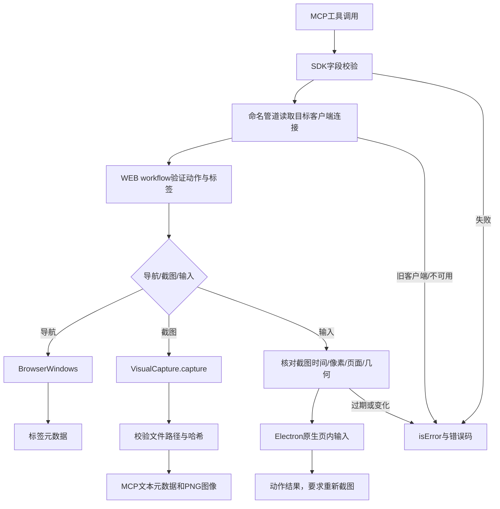
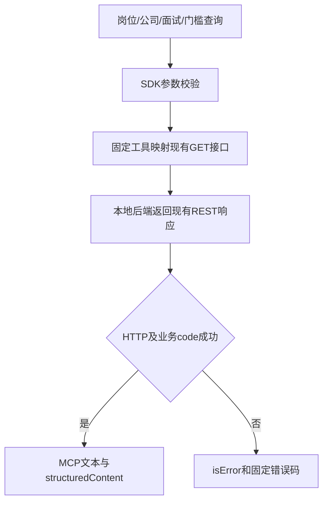

# MCP操作接口

## 需求分析

Agent 需要通过 JD Electron 打开网页、读取截图、操作搜索控件，并查询本地岗位与投递资料。调用过程不依赖桌面鼠标和全权限调试连接。

主流程：MCP客户端连接 → 查询工具 → 选择/打开Electron标签 → 截图看图 → 绑定截图进行页内操作 → 查询JD详情/历史 → 返回证据和资料。

本期能力为13个网页工具及9个查询工具，完整字段见[接口使用说明](../ops/mcp/README.md)。JD资料查询沿用现有后端的状态与分页口径。加载完成和标签标题不代表登录成功，只有实际截图可作为网页内容证据。旧客户端明确返回升级提示；超时后先核对实际状态，不自动重发。

## 架构设计

```text
MCP客户端
  └─ ops/mcp（官方SDK，stdio）
      ├─ 查询工具 → 现有本地Spring Boot API（GET）
      └─ 网页工具 → 现有本地命名管道
          └─ WEB workflow → BrowserWindows / VisualCapture
              └─ Electron WebContentsView / capturePage / sendInputEvent / insertText
```

`WEB` 是通用浏览目标类型，不加入招聘来源、岗位状态或平台账号枚举。平台专用 workflow 保留现有域名/会话归属。通用网页根据实际域名沿用对应注册会话或主机分区。网页本身不获得 MCP、文件路径或本机调用能力。

通用链接收录使用 WEB workflow v3 的内部受限 `openJob`，由任务 UUID 绑定离屏视图；该内部接口不新增 MCP 工具。MCP 仍为22个工具（13个网页、9个查询），WEB workflow 则包含14个动作，两者数量口径不同。离屏视图和接管边界见[桌面浏览器](02-桌面浏览器与多标签.md#后台收录视图)，图编排见[采集识别](04-JD采集与截图识别.md#通用链接收录架构)。

图例：`[+]` 新增，`[~]` 修改。

```text
jd-collector/
  ops/mcp/
    [+] server.mjs / desktop.mjs / call.mjs
    [+] package.json / package-lock.json / README.md
    test/[+] server.test.mjs
  frontend/
    src/common/desktop/
      [~] capture.ts
      main/
        [+] workflowBrowser.ts
        [~] workflowServer.ts / browserWindows.ts
    tests/desktop/[+] mcp-browser.spec.ts
```

截图记录沿用 `CaptureRef`，包含 key、pageRevision、sourceUrl、captureId、时间、rect、viewport、image、sha256 和 PNG 路径。数据存放继续遵守[原生截图契约](04-JD采集与截图识别.md)。

通用网页的截图来源保留定位岗位所需查询参数和 SPA 片段，敏感参数按脱敏规则处理；不能为通用页面沿用“全部删除查询及片段”的来源比较。普通标签摘要仍按桌面元数据规则脱敏，截图源地址与标签摘要用途不同。

## 开发方案

### 网页浏览与截图



`desktopRequest` 只发送类型化 WEB 动作，命名管道令牌在 Node 与 Electron 间使用，不返回 MCP 客户端。`browserWorkflow` 在公共桌面层分发命令，复用 VisualCapture 的互斥、超时、证据校验。字段明细与 keyCode 枚举由 `tools/list` 提供，入口参数表见[README](../ops/mcp/README.md#工具与参数)。

并发实现方式：原生截图与输入沿用单客户端 `VisualCapture.exclusive`，忙时返回 READ_BUSY；导航导致 pageRevision/visualEpoch 更新，待完成的旧截图不能发布或执行后续输入。MCP不持有跨请求搜索状态，状态由Electron按目标标签与截图维护；超时不自动重试。不同客户端通过 userData、命名管道与截图目录隔离。

### 本地JD资料查询



`jdRequest` 固定回环 API 基地址与 GET 方法。查询工具不建立第二份岗位、公司或阶段数据模型。数组筛选编码为重复查询参数；详情/历史通过正整数ID读取。默认后端仍为7890，隔离验收可指定回环端口。

发布顺序：安装 ops/mcp 依赖 → desktop:check → desktop:build → MCP与隔离Electron验收 → 保存页内未完成输入 → 正常重启Electron加载新管道 → 客户端连接stdio MCP。编译桌面产物不会改变正在运行的进程。

## 验收方案

| 场景 | 操作与预期 | 证据 |
| --- | --- | --- |
| 协议与查询 | 官方SDK客户端完成stdio握手、列工具、关键词/数组筛选、详情查询 | ops/mcp/test/server.test.mjs |
| 原生截图 | 独立Electron打开HTTPS夹具，PNG哈希、来源与截图ID一致 | frontend/tests/desktop/mcp-browser.spec.ts |
| 页内操作与失效 | 绑定截图滚动成功；切页后旧截图被拒；固定工作台不能被关闭或截图 | 同上 |
| 旧版本接续 | 旧Electron明确返回DESKTOP_UPDATE_REQUIRED，查询工具仍可独立使用 | MCP测试及实际info调用 |
| 既有平台 | 运行已有capture边界与真实Electron平台夹具，验证专用workflow仍可用 | 对应测试输出 |
| 真实网页 | MCP打开目标页面后主Agent实际看图；登录墙与访问限制明确记录 | runtime/captures与任务档案 |

当前实现已通过桌面类型/边界检查、5个MCP场景、通用Electron原生夹具、7个既有桥接/截图边界场景和4个招聘平台原生夹具。MCP健康、岗位查询与公司查询已对本机服务读取成功。

2026-10-16 经用户确认页内输入已保存后，正常关闭并重启 JD Electron。新进程的 info 返回通用接口版本1与13个网页动作；真实领英会话已完成三个目标主页的打开、截图和绑定截图的原生滚动，取得8张原始PNG。读取期间的页面变化/过期截图按约束拒绝后重新观察，没有放宽证据校验。人物资料、来源时间与哈希保存在私有 `local/research/新鸿基上海员工线索/`，不提交到版本库。此验收覆盖这三个资料页，不代表其他站点或全部登录流程已验证。

2026-10-17：通用 Electron MCP 浏览夹具与中键/弹窗夹具两项通过，MCP 夹具的 info 断言更新为 v3；桥接两项及截图边界五项回归通过。正常客户端重启后 info 返回 version=3、14个 WEB 动作，`genericJobCapture` 与 `backgroundJobCapture` 为 true；MCP 工具总数维持22。真实蔚来官网的后台收录样本另见[通用链接收录验收](04-JD采集与截图识别.md#通用链接收录验收)，不能将该样本推定为所有网站或 MCP 全部场景已验收。本次文档整理未重新运行产品测试。
