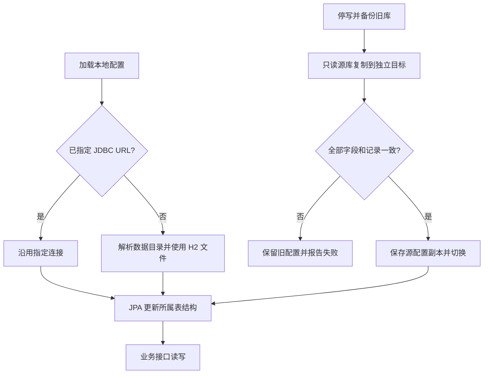
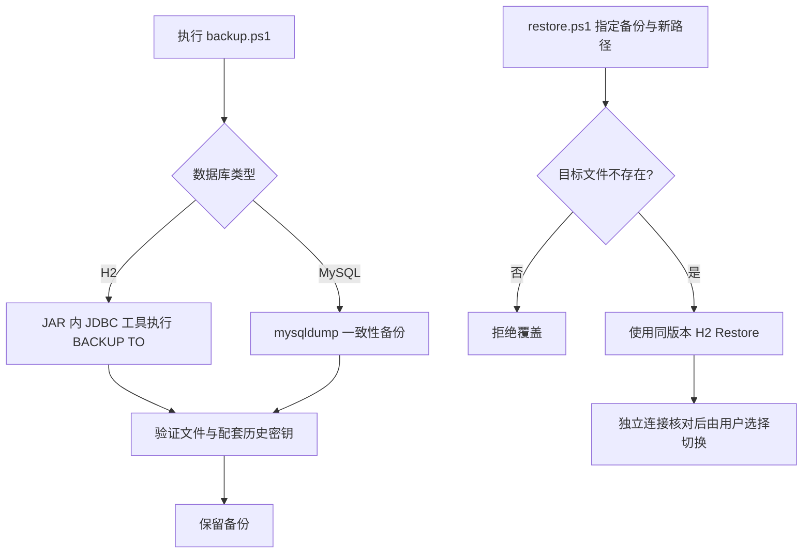

# 内嵌数据库与迁移

## 1. 需求分析

用户已授权将本机业务数据迁移到内嵌数据库，保留原 MySQL。目标是日常运行 JD Collector 不再依赖 MySQL 服务，升级、重启后原有数据与 ID 保持不变。

核心流程：停写并备份 → 创建独立 H2 文件 → 迁移全部记录 → 逐表逐字段核对 → 切换本地配置 → 启动并通过真实接口回读 → 验证新增、重启和备份恢复。

| 规则 | 要求 |
| --- | --- |
| 迁移范围 | 全部 `jd_` 表，包括归档、简历正文、知识词、投递历史、历史账号密文；共享库的 `aic_` 数据由协调迁移单独保存到面试项目文件 |
| 源库 | 迁移连接只读；原库、原数据和原配置副本保留，不清库、不回填 |
| 数据归属 | JD Collector 只管理 `jd_`，AI Interview Coach 只管理 `aic_`；跨应用逻辑 ID 保留 |
| 切换条件 | 所有源列、所有记录及 ID 核对一致；失败保留原配置，目标失败文件隔离 |
| 运行存储 | 数据文件位于可配置的本地数据目录，与构建产物分离；文件及备份均被 Git 忽略 |
| 相邻功能 | 面试项目使用新 JD 库的 SELECT 专用账号，业务库使用独立 H2 文件 |

本期包含：H2 默认配置、MySQL 配置兼容、现有数据迁移与核对、面试项目连接适配、H2 一致性备份和独立目标恢复、自检与运行文档。成功标准是全部数据一致、原 MySQL 保留、真实读写与重启通过、备份可恢复、面试来源能读取且拒绝写入。

异常：目标已有数据则停止；核对不一致不切换；文件锁或连接失败明确报错；恢复拒绝覆盖已有文件。切回旧库只用于回退迁移切换，切换后新增数据需要另行导出，不能直接覆盖丢弃。

## 2. 架构设计

```text
本机求职工作台
├─ JD Collector / Spring Data JPA
│  └─ local/data/jd-collector.mv.db：jd_ 业务表
├─ AI Interview Coach
│  ├─ JPA → local/data/ai-interview-coach.mv.db：aic_ 业务表
│  └─ jdJdbcTemplate → JD H2：SELECT 专用账号
└─ ops/backup.ps1 → H2 BACKUP TO → backups/*.zip
```

H2 驱动随可执行 JAR 分发，两个应用固定相同 H2 版本。JD 文件使用 `AUTO_SERVER=TRUE` 支持本机两个 JVM 协作访问；面试业务文件只由面试服务持有。没有独立安装的数据库服务。H2 混合模式由持有文件的 JVM 自动管理内部连接。

| 存储/配置 | 模型与约束 |
| --- | --- |
| `JD_COLLECTOR_DATA_DIR` | 字符串目录，启动脚本默认项目 `local/data`，支持安装器指定外部用户数据目录 |
| `JD_COLLECTOR_DB_URL/USERNAME/PASSWORD` | JDBC 连接；未显式配置时使用本地 H2；保留显式 MySQL 连接能力 |
| `AIC_DB_URL/USERNAME/PASSWORD` | 面试业务库，与 JD 只读连接分离 |
| `AIC_JD_DB_URL/USERNAME/PASSWORD` | 面试来源连接，H2 必须是仅有 SELECT 权限的非管理员账号 |
| 业务表结构 | 沿用现有实体、ID 和字段，JPA `ddl-auto=update`；本次数据搬迁是一次性离线工具，不增加启动 SQL |

标记：`[+]` 新增，`[~]` 修改。

```text
jd-collector/
├─ backend/app/
│  ├─ [~] build.gradle
│  ├─ src/main/resources/[~] application.yml
│  └─ src/main/java/com/jd/app/[+] DatabaseBackup.java
├─ ops/
│  ├─ [~] env.ps1 / backup.ps1 / doctor.mjs
│  └─ [+] restore.ps1
└─ config/[~] env.example.json
```

历史账号密钥、Electron 登录分区、截图、照片和门槛文件保留原位置；数据库迁移不重写这些文件。完整数据库备份和外部文件备份的范围见[数据备份与恢复](14-数据备份与恢复.md)。

## 3. 开发方案

### 3.1 默认存储与迁移切换



`ops/env.ps1` 解析目录，提供与 application.yml 一致的连接默认值。驱动由 JDBC URL 推断。迁移复制保留显式 ID，处理布尔、时间、长文本、二进制与 NULL；自增起点大于源最大 ID。包含未被当前实体映射的历史列和历史表，不通过公共列表分页搬运数据。

并发实现方式：实际复制期间停止两个应用；MySQL 源连接使用一致性只读事务；目标独立，未通过核对不接入业务。正常运行由 H2 行锁/JPA 事务保持原业务约束，AUTO_SERVER 负责文件持有者与其他 JVM 的连接切换。只读连接同时设置 JDBC readOnly 和数据库 SELECT 授权，不能依赖 H2 的 readOnly 提示阻止写入。

### 3.2 备份与独立恢复



| 入口 | 参数 | 结果/异常 |
| --- | --- | --- |
| `ops/backup.ps1` | 可选 `AccountKeyPath` | H2 ZIP 或 MySQL SQL；非空验证，存在历史密钥时复制并校验 SHA-256 |
| `ops/restore.ps1` | 必填 `BackupFile`、`DatabasePath`（不含 `.mv.db`） | 恢复到不存在的新目标；不修改运行配置，不覆盖文件 |
| `DatabaseBackup` | 备份目标路径 | 从环境读取连接；失败仅输出错误类型/SQLState，不回显凭据或数据 |
| `doctor.mjs` | 原有选项 | H2 检查配置/数据目录，MySQL 检查 TCP；运行检查仍经真实接口 |

## 4. 验收方案

证据保存在忽略目录 `runtime/database-migration-20261026/`；原库备份在 `backups/`。不新增 Bruno 集合，遵循仓库约定使用真实 HTTP 和数据库核对。

| 编号 | 操作与预期 | 相邻检查 | 状态 |
| --- | --- | --- | --- |
| DB-001 | 源库备份非空、全部表和列逐字段一致，归档及 ID 保留 | aic_ 数据独立保留 | PASS |
| DB-002 | 新 H2 启动，JD/公司/简历/知识词/历史接口与迁移前一致 | 面试 JD 与简历来源 | PASS |
| DB-003 | 隔离库通过真实 HTTP 新增与更新，重启后记录保留，自增不冲突 | 投递历史与事务 | PASS |
| DB-004 | 两 JVM 同时访问 JD，新 JD 对面试可见，面试只读连接拒绝写入 | 先启动任一应用均可 | PASS |
| DB-005 | H2 在线备份后独立恢复，表/字段/记录一致，已有目标拒绝覆盖 | 历史密钥哈希一致 | PASS |
| DB-006 | 原 MySQL 数据最终核对不变，两个应用已连接新库 | 原 MySQL 服务保留 | PASS |

### 实际执行结果（2026-10-26，Codex）

- 全部源业务表及历史表逐字段规范化 SHA-256 一致，包含归档及未显示在默认列表中的记录。个人数据数量与明细保存在忽略的本地证据目录。
- 正式切换前后 10 组 HTTP 结果逐对象相等：岗位、公司、简历、面试安排、知识词列表、面试 B/A/S 来源、面试简历来源和历史列表。地址仍为 JD 7890、面试后端 8080 / 前端 5173。
- 隔离副本通过 HTTP 新建公司/工作地点/岗位、更新长文本、阶段变更及事件回读；新增 ID 大于迁移前最大值。中文、emoji、引号与换行往返一致；重启后内容哈希和阶段事件保留。正式库未加入这些夹具。
- 两 JVM 并行访问成功；JD 进程退出后面试继续读取成功，面试先启动、JD 后启动也成功。独立无 DB_URL 配置的 JAR 实际创建 H2 并通过空库接口。
- H2 账号测试实际验证 SELECT 成功、UPDATE/DROP 失败，并拒绝管理员、具有写权限或无 SELECT 权限的来源账号；正式面试服务通过相同启动检查。
- 在线 ZIP 备份使用原配置入口生成，独立恢复后 14 张 JD 表所有字段/记录与在线库一致；已有目标恢复被拒绝，配套历史密钥哈希一致。面试文件在停机状态另存迁移检查点副本。
- 正式切换后 MySQL 的 23 张表与冻结时摘要完全相同，MySQL80 服务仍运行，两个新后端没有到 3306 的连接。数据库及本地配置均已被 Git 忽略。
- 后端构建和相关回归通过；JD 现有结果汇总 99 项 / 0 失败 / 1 跳过，面试 86 项 / 0 失败 / 3 跳过，部分未变模块复用 Gradle 缓存。doctor 与公开源码规则测试通过。本轮未调用真实模型、真人语音或操作招聘网站。

证据：工作区 `.runtime/database-migration-20261026/` 的 `final-check-{source,target}.json`、`mysql-after-cutover.json`、`api-{before,after}/`、`dryrun/write-check.json`、`final-restore-check-{live,restored}.json` 与 `迁移记录.md`。原 SQL 与 H2 ZIP/检查点副本在各应用忽略的 backups 下；原连接配置副本保留在证据目录。
